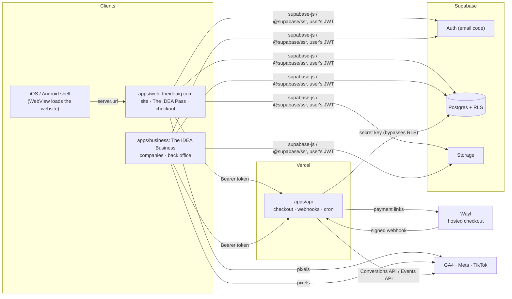
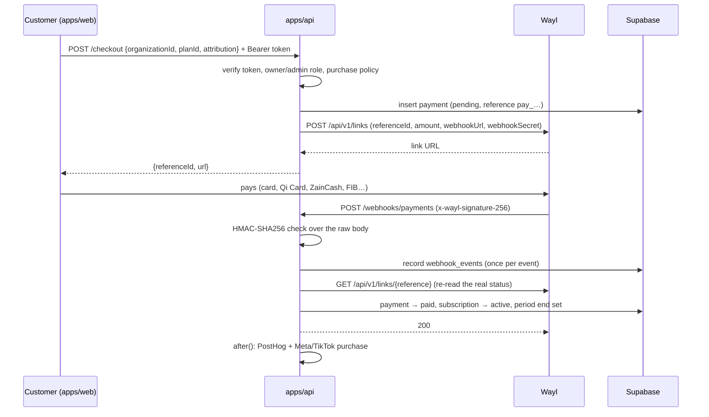

# Architecture and integrations guide

This guide is for the people who set up, run and hand over a project built on
this monorepo: consultants, tech leads and the developers who maintain it. It
explains how the pieces fit together and walks through each integration step
by step.

| Section | You need it when you… |
| --- | --- |
| [Architecture at a glance](#architecture-at-a-glance) | join the project or review a change |
| [1. Create a project from the template](#1-create-a-project-from-the-template) | start a new client or product |
| [2. Supabase migrations and Row Level Security](#2-supabase-migrations-and-row-level-security) | change the database or its access rules |
| [3. Build, sync and release the iOS and Android apps](#3-build-sync-and-release-the-ios-and-android-apps) | ship the mobile apps |
| [4. Marketing tracking and Wayl payments](#4-marketing-tracking-and-wayl-payments) | set up ads attribution, newsletters or take real payments |
| [5. Vercel environment variables](#5-vercel-environment-variables) | deploy the web apps |

`AGENTS.md` holds the short list of coding rules; this document is the long
form.

---

## Architecture at a glance



### The apps

| App | Port | What it is | How it is deployed |
| --- | --- | --- | --- |
| `apps/web` | 3001 | **theideaiq.com**, everything customers see (see [The website](#the-website)): the public pages (The IDEA Store: home, catalog and product pages; The IDEA Plus; The IDEA Club: posts and events; `/business` for companies; saved products; help and contact; careers; legal in `apps/web/content/legal`), **The IDEA Pass** (sign-in, authenticator app, and its pages at `/pass`: the card, orders and Sell to us, Bulbs and invites, settings), the cart and checkout. Public pages are Server Components with ISR; the signed-in parts are client components. Its `proxy.ts` adds the locale, refreshes the cookie session and sets the security headers. | Vercel; the iOS/Android apps load it in a WebView (section 3) |
| `apps/business` | 3000 | **The IDEA Business** (`business.theideaiq.com`), for companies and staff: the company dashboard at its root and the staff **back office** under `/{locale}/staff` (see [The IDEA Business](#the-idea-business)). No sign-in of its own: it sends people to The IDEA Pass on the website. | Vercel |
| `apps/api` | 3002 | Everything that needs a secret: Wayl checkout and webhooks, cron jobs, account and organization deletion, push notifications, the back office's privileged steps (`app/admin/*`), the website's contact form and status badge. Route handlers only. | Vercel |
| `apps/docs` | 3004 | Mintlify documentation site. | Mintlify |
| `apps/storybook` | 6006 | **The IDEA Design**: the staff-only design site with every UI component and email template (see [The IDEA Design](#the-idea-design)). | Vercel (`design.theideaiq.com`) |

### The IDEA Design

`apps/storybook` is the one place to review UI and email. `bun run dev`
there is plain Storybook on port 6006 (no gate). `bun run build` runs
`storybook build -o public` and then `next build`: the Next.js shell has
no pages of its own and serves the static build, with `proxy.ts` in front
of every path (the manager, the iframe and every asset):

1. It reads the Supabase session cookie that The IDEA Pass writes
   (`sb-<project ref>-auth-token`, whole or chunked, `base64-` or plain),
   shared across subdomains when `NEXT_PUBLIC_AUTH_COOKIE_DOMAIN` is set.
2. No cookie, an expired token or one Supabase rejects (`getClaims`, with
   the publishable key): redirect to
   `${NEXT_PUBLIC_WEB_URL}/{locale}/sign-in?return_to=<this URL>` (The IDEA
   Pass, on the website). The gate never refreshes a session (that would
   spend the browser's refresh token); the website refreshes it and sends
   the visitor back.
3. It reads the visitor's own `staff` row as that user (RLS lets everyone
   read their own row). No row: a plain bilingual 403 page. A row but an
   `aal1` token: redirect to Pass `/{locale}/mfa`, since staff rights need an
   authenticator app. Tokens issued to third-party apps (`client_id`) are
   refused.

The locale comes from `NEXT_LOCALE`, then `Accept-Language`, then Arabic.
Responses are `Cache-Control: private, no-store` and `noindex`. Environment:
`NEXT_PUBLIC_SUPABASE_URL`, `NEXT_PUBLIC_SUPABASE_PUBLISHABLE_KEY` (unset =
503, fail closed) and `NEXT_PUBLIC_WEB_URL` (defaults to
`http://localhost:3001` in development, `https://theideaiq.com`
otherwise). Other apps link to it with
`NEXT_PUBLIC_DESIGN_URL` (`@repo/next-config/keys`). Emails are reviewed
under **The IDEA Design → Emails**, rendered with `@react-email/components`
exactly as Resend sends them; add a story there with every new template.

### The website

`apps/web` (port 3001, `theideaiq.com`) holds every customer feature, in
one Next.js app. Messages come from the `web`, `app`, `pass`, `auth`,
`store`, `billing` and `common` namespaces. Analytics and the ad pixels
load on every page (never inside the iOS/Android apps).

| Area | Routes | Code |
| --- | --- | --- |
| Public pages | The IDEA Store: `/{locale}`, `/store`, `/store/<slug>`; The IDEA Plus: `/plus` (rental catalog, plans, tiers; "Your Plus" at `#yours` when signed in: membership, plans, rentals, rental requests); The IDEA Club: `/club` (one feed with chips, `?show=events\|news\|stories\|guides`; "Yours" at `#yours`: your events with the calendar feed and your submissions; the Telegram rooms card) and `/club/<slug>` (a post or an event); `/business`; `/saved`; `/help` (FAQ, contact form at `#contact`, Ask Droid, the member's support tickets at `/help/<id>` and `/help/new`); `/careers`; `/about`; `/r/<code>`; `/legal/<policy>` | `app/[locale]/*` (Server Components, ISR), with client islands for buying (`components/store/purchase-panel.tsx`), reviews (`WriteReview`) and RSVPs (`components/rsvp-button.tsx`) |
| The IDEA Pass (sign-in) | `/{locale}/sign-in`, `/mfa`, `/tg`, `/sign-out`, `/auth/callback`, `/onboarding` | `app/[locale]/(pass)`, `components/pass`, `lib/pass` |
| The IDEA Pass (pages) | `/{locale}/pass` (the membership card), `/pass/orders` (orders, then Sell to us at `#sell`), `/pass/orders/<id>`, `/pass/bulbs` (Bulbs, then invites and affiliates at `#invite`), `/pass/settings` | `app/[locale]/pass`, `components/screens` (client components with TanStack Query) |
| Cart and checkout | `/{locale}/cart`, `/checkout` | `app/[locale]/(checkout)` |

- **Session.** The browser client (`@repo/auth/client`) and the server
  client (`@repo/auth/server`) share the `@supabase/ssr` cookie;
  `proxy.ts` refreshes it on every request (`refreshSession`), so Server
  Components and Server Actions read a valid token. Every query runs as
  the signed-in user with the publishable key, so RLS applies. The
  iOS/Android shell loads the same pages, so the same cookie applies there.
- **Navigation.** The menu is Store · Plus · Club · Pass (a bottom tab
  bar on phones). The top bar holds the logo, search, saved (a heart, to
  `/saved`), the cart and, on desktop, the Pass avatar ("Sign in", coming
  back to the same page, when signed out); saved and the cart are hidden
  on sign-in and checkout. The desktop header reads Store · Plus · Club,
  "For business", saved, cart, Pass. The footer lists Store · Plus · Club
  · Pass · Business, then About · Careers · Help · Legal.
- **The IDEA Club.** One feed at `/club` of events, news, stories and
  guides (online only), filtered by chips (`?show=events|news|stories|guides`).
  Posts have a section (`news`, `stories` for features and members' work,
  `learn` for guides; the old `members` value is refused since
  `20261207000000_post_restructure.sql`). Posts have an optional byline
  (empty means The IDEA), and `/club/<slug>` is a post or an event (the
  database keeps slugs off the section names). Members submit work from
  the Club; editors review it blind in the back office (Editorial →
  Submissions) and, once it is accepted, **Create the post** opens a
  draft in Stories with the member's name as the byline
  (`posts.submission_id`; only accepted submissions, once each). The
  guides view also carries the learning programs and their "register
  your interest" link (to `/help#contact`). Migration
  `20261127000000_the_post.sql` retired the PDF journal issues.
- **Old links.** Old addresses (`/post/…`, `/suite`, `/about/faq`,
  `/about/contact`, `/about/careers`, `/pass/wishlist`, `/pass/support`,
  `/i/<code>`, `/a/<code>`, …) have no HTTP redirects. Links stored in
  older shapes (notifications, push, Telegram), including the static-export
  detail links (`/store/product?slug=…`, `/orders/view?id=…`,
  `/support/view?id=…`), are mapped to the current page by
  `currentAppPath` (and `businessPath` for The IDEA Business) in
  `packages/internationalization/app-paths.ts`.
- **Locale.** English, the default, has no prefix (`/store`); Arabic is
  `/ar/store` (next-intl `localePrefix: "as-needed"`). `proxy.ts` sends
  visitors to their language (cookie, then `Accept-Language`, then
  English) and serves unprefixed paths in English; `<html lang dir>` are
  set on the server. Link with `Link`/`useRouter` from
  `@repo/internationalization/navigation`, and build any other path with
  `localePath(locale, path)` from `@repo/internationalization` (never
  `` `/${locale}…` `` by hand). `/.well-known` (app links) is left alone.
- **Indexing.** The IDEA Pass and its pages, saved products, the cart and
  checkout send `noindex`
  (metadata and `X-Robots-Tag`).

### The IDEA Business

`apps/business` (package `business`, port 3000, `business.theideaiq.com`)
is for companies and staff. Messages come from the `app`, `admin` and
`billing` namespaces. The company dashboard is at its root; the staff back
office is under `/{locale}/staff`.

| Area | Routes | Code |
| --- | --- | --- |
| Company dashboard | `/{locale}` (Overview: quotes to answer, open requests, unpaid invoices, Plus members, plan), `/procurement` (requests and quotes, `/procurement/<id>`), `/hiring` (jobs and candidates, `/hiring/<id>`), `/invoices`, `/plus` (The IDEA Plus for the team), `/documents/<quote\|order\|invoice>/<id>` (printable), `/members`, `/billing`, `/settings`, `/new`, `/invite` | `app/[locale]/(business)`, `components/screens`, `components/business` |
| Back office | `/{locale}/staff/…`: the dashboard (an inbox of what's waiting, then the numbers), the counter, search (`/staff/search`), then sections grouped by Today, Sales (orders, rentals, trade-ins, customers and CRM), Catalog (catalog, reviews), Community (editorial, Telegram, affiliates), Companies (`/staff/companies`), Money (finance), Help (support) and Team (staff, audit log) | `app/[locale]/staff`, `components/admin`, `lib/admin` |

- **Sign-in.** The IDEA Business has none of its own: signed-out visitors
  go to The IDEA Pass on the website (`passUrl` from `@repo/auth/pass`)
  with `return_to` set to the page, and the shared cookie on
  `NEXT_PUBLIC_AUTH_COOKIE_DOMAIN` signs them in here too. Old paths
  (`/business/…`, `/admin/…`) have no redirects; stored notification links
  under `/business…` open the page at the root here (`/business/invoices`
  → `/invoices`, `businessPath` in `packages/internationalization/app-paths.ts`).
- **Procurement.** A company's owners and admins send a
  request (what they need, an optional budget and date). Support answers in
  Back office → Companies with one or more quotes (priced lines) and
  sends them; the company's owners and admins get a `quote_sent`
  notification and accept one (with their own PO reference; the others are
  withdrawn) or decline. An accepted quote becomes a purchase order;
  support marks it delivered and finance issues its invoice (due in 30
  days by default, `invoice_issued` notification) and marks it paid. Every
  member of the company sees its requests, sent quotes, orders and
  invoices; drafts stay with staff. Tables `procurement_requests`,
  `quotes`, `quote_lines`, `purchase_orders`, `invoices`; the steps are
  RPCs (`send_quote`, `decide_quote`, `cancel_procurement_request`,
  `set_purchase_order_status`, `issue_invoice`, `set_invoice_status`),
  migration `20261206000000_suite_procurement.sql`. The website's
  notification bell opens company links on The IDEA Business.
- **Hiring.** Owners and admins post a job request (role,
  details, location, contract, salary range, how many people). Support
  proposes vetted candidates in Back office → Companies → Hiring
  (name, headline, summary and a PDF CV uploaded to the private
  `candidates` bucket under `<organization id>/…`); the company's owners
  and admins get a `candidate_proposed` notification and shortlist,
  reject or hire, with an optional note. Hiring as many as asked fills the
  job; owners, admins or support can close it. Every member of the company
  sees its jobs and candidates (withdrawn ones stay with staff) and opens
  CVs through short-lived signed links. Tables `job_requests`,
  `candidates`; RPCs `decide_candidate`, `close_job_request`; migration
  `20261209000000_suite_hiring.sql`.
- **Printable documents.** `/documents/quote/<id>`, `/documents/order/<id>`
  and `/documents/invoice/<id>` lay a quote, purchase order or invoice out
  for paper; the browser's print dialog prints it or saves it as a PDF
  (Arabic and English alike, which PDF libraries render poorly). Company
  members and support/finance staff can open them (RLS).
- **The IDEA Plus for a company's team.** Owners and admins ask for a
  monthly Plus plan for a member (The IDEA Business → The IDEA Plus); finance
  approves it in Back office → Companies → The IDEA Plus seats, which
  gives the member a Plus subscription (provider `company`, so rentals and
  tiers work as usual; the Wayl renewals skip it) and invoices the company
  for the first month. `GET /cron/plus-seats` (daily, 06:15 UTC) extends
  the seats due within three days by a month and invoices each company
  once for them. Ending a seat, or the member leaving the company, lets the
  month run out. Invoices can now have a description instead of a purchase
  order. Table `plus_seats`; RPCs `request_plus_seat`, `activate_plus_seat`,
  `decline_plus_seat`, `end_plus_seat`, `run_plus_seat_renewals`; migration
  `20261208000000_team_plus.sql`.
- **Back office tools.** The dashboard opens on "Waiting on you": unassigned
  tickets, orders to prepare, rental requests and overdue rentals, new
  trade-ins, submissions, Telegram requests, affiliate applications,
  procurement requests to quote, jobs without candidates, Plus seats to
  approve and overdue company invoices, each for the roles that handle
  them (`lib/admin/inbox.ts`). The sidebar's search (`/staff/search`)
  looks up order, ticket, request and job numbers, members by name or Pass
  number, and products. The counter (`/staff/counter`, support) checks a
  member's The IDEA Pass with the camera (where the browser has
  BarcodeDetector), a USB scanner or by typing, then shows their Bulbs,
  Plus and open rentals and checks them in at events around now
  (`check_in_rsvp`, now open to support too; migration
  `20261210000000_counter.sql`).
- **Indexing.** Every page sends `noindex`.

### The IDEA Pass

The Pass is the only sign-in UI on the web, for customers and
staff alike, and what a person's membership is called (the word "account"
is never shown). Its pages are part of the website (ar/en, RTL) and hold
no secrets: they sign people in with the publishable key and leave the
session in the shared cookie.

- **Routes.** `/{locale}/sign-in?return_to=…` (a 6-digit code by email,
  `@repo/auth/components/email-otp-form`; it signs in or creates the Pass,
  and there is no separate sign-up page),
  `/{locale}/mfa?return_to=…` (link or enter the authenticator app, which
  raises the session to AAL2), `/{locale}/sign-out?return_to=…` and
  `/{locale}/pass` (the membership card; with `/pass/orders`,
  `/pass/bulbs` and `/pass/settings`). Other apps link to them with
  `passUrl(path, returnTo, locale)` from `@repo/auth/pass`, which builds
  URLs on `NEXT_PUBLIC_WEB_URL` (`"/"` is `/pass`).
- **Sign-in method: an email code** (decision 2026-10-24; no SMS plan). No
  passwords and no magic links: links open outside the iOS/Android shell,
  so the session would land in the wrong browser. `EmailOtpForm` asks for
  the email, calls
  `signInWithOtp({ email, options: { shouldCreateUser, data: { full_name, locale } } })`,
  then takes the 6-digit code and calls
  `verifyOtp({ email, token, type: "email" })` (`sendEmailOtp` and
  `verifyEmailOtp` in `@repo/auth/otp`). The sign-in page passes
  `shouldCreateUser: true`: a new address gets its Pass (Supabase sends its
  **Confirm signup** email, and the code both confirms the address and
  signs in; `/onboarding` then asks for the name), and an address we know
  gets the **Magic Link** email, whose template shows only the code. Codes have 6 digits and last
  10 minutes; the form allows a resend after 60 s and changing the
  address, and translates the errors (invalid email, wrong code, expired
  code, too many attempts). The templates are in
  `packages/database/supabase/templates/` (one email in Arabic and English,
  branded The IDEA Pass, the code in large type); production uses the same
  files (2.7).
- **Staff** sign in the same way; the back office and the database still
  require the authenticator-app step (AAL2) afterwards.
- **Phone sign-in is switched off, not removed.** The phone provider is
  disabled (`[auth.sms]` in `config.toml`, and in production). The phone
  helpers stay: `@repo/auth/phone` (normalizing and formatting Iraqi
  numbers, used for delivery addresses, invitations and the staff lookup),
  `sendPhoneOtp`/`verifyPhoneOtp` in `@repo/auth/otp` and the Send SMS hook
  (`functions/send-sms`). To bring phone sign-in back: enable the provider
  (or the hook) and a phone form next to `EmailOtpForm` (the earlier
  `PhoneOtpForm` is in git history, `packages/auth/components/phone-otp-form.tsx`).
- **Shared session cookie.** `NEXT_PUBLIC_AUTH_COOKIE_DOMAIN=.theideaiq.com`
  makes the browser client, the server client and the proxy session refresh
  (`authCookieOptions()` in `packages/auth/cookies.ts`) write the
  `@supabase/ssr` cookie (`sb-<project ref>-auth-token`, chunked `.0`, `.1`,
  possibly `base64-` prefixed) for the whole domain, so `theideaiq.com`,
  `business.` and `design.` read the same session. Set the same value on web,
  app (The IDEA Business) and storybook; leave it unset locally and on previews (host-only
  cookie; on localhost cookies are shared across ports anyway).
- **return_to.** A path on the website (`/cart`, `/ar/cart`) is kept as is. An
  absolute URL must be http(s) on the host of `NEXT_PUBLIC_WEB_URL`,
  `_APP_URL`, `_DESIGN_URL` or `_API_URL` (plus localhost in development,
  `isAllowedReturnTo`); anything else falls back to the website
  (`safeReturnTo`). The older `?next=/cart` still works. Without a
  destination, sign-in and the authenticator step go to `/pass`. After signing
  in the browser does a full navigation, so the next page reads the cookie.
- **Sign-out.** The buttons (Pass settings, the authenticator step) remove this
  device's push registration and then call a Server Action. The back
  office links to `/sign-out` on the website, which signs out only on
  navigations from The IDEA's own sites (`Sec-Fetch-Site: same-site` or
  `same-origin`); a link from anywhere else lands on `/pass` instead.
- **Gates.** On the website `RequireAuth` (the Pass pages, the cart,
  checkout) sends signed-out visitors to `/{locale}/sign-in?return_to=<the page>`;
  The IDEA Business's gates send them to the same page with an absolute `return_to`.
- **Later: OAuth consent.** Signing in to third-party apps with The IDEA
  Pass can use Supabase Auth's OAuth 2.1 server (Authentication → OAuth
  Server): Supabase sends people to an authorization page (for example
  `/{locale}/oauth/consent?authorization_id=…`), which shows the client and
  scopes and calls `supabase.auth.oauth.approveAuthorization` or
  `denyAuthorization`. Add it under `apps/web/app/[locale]/(pass)`;
  the sign-in redirect with return_to already brings people back to it.
- **The card.** `/pass` opens with the membership card
  (`apps/web/components/pass`): an ID-1 card with guilloché drawn from
  formulas, a sheen that follows the pointer, the member's name and
  number (`profiles.member_number`, from 100001) and a QR code with a
  6-digit code that changes every 30 seconds. The code is TOTP (RFC 6238,
  HMAC-SHA1): `my_pass_secret()` hands the member their own secret once,
  the device keeps it as a non-extractable Web Crypto key in IndexedDB
  (never the secret in clear text) and works the code out itself, so
  the card works offline and in the iOS/Android apps with no server call.
  The QR code carries `IDEA:<member number>:<code>`; at the counter staff
  scan it into **Customers → Check a Pass**, which calls `check_pass()`
  (support staff and admins, AAL2) and accepts the current code and the
  ones either side of it. A screenshot stops working within a minute.
- **Bulbs.** The IDEA Pass rewards (migration `20261128000000_bulbs.sql`):
  1 Bulb = 100 IQD. Every movement is a row in `bulb_entries`, written only
  by triggers and SECURITY DEFINER functions (no insert, update or delete
  policy). A delivered order earns a flat rate on the items (not
  delivery): `store_settings.bulb_rate` (3%) for everyone, or the member's
  Plus plan `plans.bulb_rate` (Glow 4%, Shine 5%, Blaze 6%), times the
  category's or product's `bulb_multiplier` (consoles and laptops 0.5)
  and at most half on any item over `store_settings.bulb_half_from`
  (500,000 IQD), plus a one-time 20-Bulb first-order bonus; both stay
  `pending` through the return window (`store_settings.return_days`, 14
  days, read by `private.return_window()`), count as usable once
  `available_at` passes, and a cancelled or refunded order voids them. A completed trade-in earns 10, and a
  store-credit payout is paid in Bulbs at 120% of the offer. There are no
  spend tiers (migration `20261218000000_money_rules.sql` removed them):
  the card is pink for everyone, with a special finish for Plus members.
  Members read `my_bulbs()` (`/pass/bulbs`); support
  sees and adjusts a member's Bulbs with a reason on the customer page
  (`member_bulbs`, `adjust_bulbs`, audited); finance sees what members hold
  and edits the money rules and the category multipliers (Finance → Bulbs,
  `bulbs_outstanding`, `set_money_rules`). `GET /cron/bulbs` (daily, 03:30
  UTC) runs `run_bulb_expiry()`: a reminder after 11 months without
  activity and expiry at 12.
- **Spending Bulbs** (migration
  `20261129000000_bulbs_checkout.sql`). `create_order(…, use_bulbs)` takes
  up to the whole order (delivery included) in Bulbs at 100 IQD each,
  from what is usable now (a per-member advisory lock serialises
  checkouts), records `orders.bulbs_used`/`bulbs_discount` and writes a
  `redemption` entry; an order paid in full with Bulbs is paid at once
  (`complete_order_payment`, no hosted checkout; the confirmation email
  goes through `POST /orders/confirmation`). Cancelling or refunding
  voids the redemption (the Bulbs come back), and cashback is earned only
  on the share paid in money. Plus payments can't take Bulbs yet.
- **Money rules and the checkout quote** (migration
  `20261218000000_money_rules.sql`). One function,
  `private.price_checkout()`, prices an order for both `create_order()`
  and the checkout page (`checkout_quote()`, which the website shows
  instead of working the total out itself): the zone's fee, free delivery
  in a zone over `delivery_zones.free_from` (Baghdad 150,000 IQD) or on
  any order for a Plus plan with `free_delivery` in a zone with
  `plus_free_delivery` (Shine and Blaze in Baghdad), the invite or
  affiliate discount, then Bulbs. The total giveaway on an order (delivery
  waived, discount, affiliate commission and the Bulbs it will earn) is
  capped at `store_settings.max_giveaway_rate` (20%) of the items: the
  discount shrinks first, then `orders.max_bulbs` caps the cashback. Cash
  on delivery is refused over `store_settings.cash_limit` (500,000 IQD;
  those orders are paid online or at pickup). Every copy has a cost
  (`stock_items.cost`); `price_check()` (Finance → Prices) lists sale
  copies with no cost or priced under the floor: cost plus the payment
  fee (`payment_fee_rate`), our delivery cost (`delivery_cost`) and the
  largest giveaway, with at least `min_margin_rate` (20%) left. Finance
  edits all of these on Finance → Bulbs (`set_money_rules`).
- **Plus plans** (same migration). Glow 14,750 IQD (1 item), Shine 22,750
  (2) and Blaze 39,750 (4) are seeded inactive in production; staff turn
  them on at launch (Catalog → Plans), where each plan's Bulbs rate and
  free delivery are edited too. Telegram rooms are open, for Pass holders
  (`pass`) or for Plus members (`plus`).
- **Invite friends** (migration `20261130000000_referrals.sql`). Every
  member has `profiles.invite_code` (read through `my_invites()`; the
  column isn't granted to clients) and shares
  `theideaiq.com/r/<code>` (the page asks `referral_kind(code)` whether
  it is an invite or an affiliate code). The page remembers the code on the device
  (`lib/invites.ts`, 30 days) and `InviteClaimer` calls `claim_invite()`
  once the visitor is signed in: new members only (no paid or confirmed
  order), one inviter each, never themselves (`referrals`). Their first
  order gets 10% off, at most 15,000 IQD (`orders.discount`,
  `discount_source = 'invite'`, priced in `create_order()` and mirrored by
  `cartTotals()`), on one order only. When it's delivered the inviter
  earns 50 Bulbs, pending through the return window and voided by a
  refund, at most 20 a month, and none when the friend's order shares a
  phone number or address with the inviter's own orders. The invite card
  is on `/pass/bulbs#invite`.
- **Affiliates** (migration `20261201000000_affiliates.sql`). Members
  apply on `/pass/bulbs#invite` (`apply_affiliate()`); marketing approves
  them in the back office with a code (`decide_affiliate()`, which also
  notifies them). The link `theideaiq.com/r/<code>` is remembered on the
  device until sign-in (`lib/affiliates.ts`, `AffiliateToucher`) and, like
  the code typed at checkout, recorded by `touch_affiliate()` in
  `affiliate_attributions` (the last link or code wins; a code typed at
  checkout replaces a link). For 30 days the member's orders get 5% off
  (`orders.discount`, `discount_source = 'affiliate'`,
  `orders.affiliate_id`); one discount per order, the larger of the invite
  and the affiliate's, mirrored by `orderDiscount()` in `@repo/commerce`.
  A delivered order earns the category's `affiliate_rate` (8% vinyl, CDs
  and books, 3% otherwise; Back office → Affiliates, finance) on the price
  after the discount, held through the return window (14 days); nothing when the order
  shares a phone number or address with the affiliate. A new Plus member's
  first membership (attributed on its first payments,
  `subscriptions.affiliate_id`) earns 20% of the first 3 monthly payments
  or a quarter of a yearly one. Refunds void unpaid commissions and claw
  back paid ones from the next payout (`affiliate_commissions`). Finance
  records a payout of everything ready from 25,000 IQD
  (`record_affiliate_payout()`): by ZainCash, FIB, Qi or bank transfer with
  its reference, or as Bulbs worth 20% more, credited at once.
- **More Bulbs** (migration `20261205000000_bulbs_extras.sql`). The IDEA
  Plus payments earn cashback at the member's rate when paid
  (`bulbs_on_payment`, voided on refund); `run_birthday_bulbs()` (daily
  `/cron/bulbs`) pays 25 Bulbs on birthdays in Baghdad time with a
  `bulbs_birthday` notification (`profiles.birthday`, read only through
  `my_birthday()`, set once by the member); a published review with photos
  (`product_reviews.photos`, public `reviews` bucket, "<user id>/…") of a
  bought or rented product earns 5 Bulbs once; `check_in_rsvp()` (editors)
  marks `event_rsvps.checked_in_at` and pays 10 Bulbs once per event.
- **Telegram sign-in** (migration `20261202000000_telegram_login.sql`).
  Telegram's OpenID Connect (core.telegram.org/bots/telegram-login), run
  by the API with the bot's Client ID and Secret (`TELEGRAM_LOGIN_*`, from
  @BotFather → Login Widget, whose Allowed URLs include
  `<API URL>/auth/telegram/callback`). `GET /auth/telegram/start` keeps the
  state, PKCE verifier and `return_to` in a signed 10-minute cookie and
  sends the browser to Telegram (scope `openid profile
  telegram:bot_access`); `GET /auth/telegram/callback` exchanges the code
  and checks the ID token against Telegram's keys (`jose`,
  `lib/telegram-login`). A Telegram account already linked
  (`telegram_members.user_id`) signs in through a one-time magic-link token
  (`auth.admin.generateLink`) that `/sign-in/telegram` on the website
  verifies; a new one comes back with a signed ticket: the member signs in
  with an email code there (receipts and recovery) and
  `POST /auth/telegram/link` links it with `link_telegram()` (service
  only: one account per member, never someone else's; 10 Bulbs the first
  time). From `/pass/settings` the flow runs with `mode=link`, so it
  always links to the signed-in member and never switches accounts;
  `unlink_telegram()` disconnects. `GET /auth/telegram/available` tells the
  website whether to show the buttons.
- **The Mini App** (`/tg` on the website). Droid's "Shop the store" button
  and the chat menu button (`setChatMenuButton`, set by `telegram:setup`)
  open the website inside Telegram. The page loads Telegram's Web App
  script and posts its signed `initData` to `POST /auth/telegram/web-app`,
  which checks it with the bot's token (HMAC-SHA256 with the key
  `WebAppData`, at most an hour old; `lib/telegram-login/web-app.ts`) and
  answers like the sign-in callback: a one-time token for a linked account
  or a link ticket for a new one, finished by `/sign-in/telegram`. Link
  tickets are sealed with the Login client secret, or the bot's token when
  only the Mini App is set up. The website's security headers allow
  Telegram Web to frame it (`telegramMiniAppCspSources`: CSP
  `frame-ancestors` for `web.telegram.org`, no `X-Frame-Options`).
- **Droid** (`packages/droid`, webhook `apps/api/app/telegram/webhook`).
  A menu in private chats: Track my order and My Bulbs for members who
  linked Telegram (`telegram_members.user_id`; others get a link to
  `/pass/settings`), store search, Talk to us (a support ticket in `/help`
  for members, a Telegram request in the back office otherwise),
  The IDEA Plus, FAQ (topics `general`, `store`, `plus`, `club` and
  `business`, migration `20261217000000_program_revision_names.sql`),
  links and the newsletter. Inline mode
  (`@TheIdeaDroidBot <product>` in any chat) shares products. In groups and
  channels it records membership and sends new channel posts to newsletter
  subscribers; moderation (word filters, spam, flood muting, network-wide
  bans, unban requests) and the AI assistant were removed in favour of
  Telegram's own tools. `bun run --cwd apps/api telegram:setup` sets the
  webhook, its update types and the command lists.
  **The Club's join rules** (migration `20261203000000_telegram_club.sql`):
  each chat in Back office → Telegram → Chats has `join_rule` (anyone,
  members with a linked The IDEA Pass, or a Bulbs tier and up). For chats
  whose invite link asks to approve new members, Droid approves join
  requests that pass `telegram_join_check()` and declines the rest with a
  message saying how to qualify (connect Telegram, or reach the tier).
  **Order updates on Telegram:** the notifications webhook and the push
  catch-up cron also send each notification as a Droid message (its title,
  a generic line and a button to the page on the website) to members who
  linked Telegram, claimed once with `claim_telegram_notifications()`.
  **Automatic topic posts** (migration `20261204000000_telegram_posts.sql`):
  each chat can name a forum topic for news (`news_topic`), events
  (`events_topic`) and new arrivals (`arrivals_topic`); 0 is the chat
  itself (General, or a channel), empty is off, and `post_locale` picks the
  language. Triggers queue a post of The IDEA Club when it's published, a
  published upcoming event, and a product added in the last two weeks when
  it goes on sale or for rent (`telegram_posts`). A Supabase Database
  Webhook on inserts into `telegram_posts` calls
  `POST /webhooks/telegram-posts` (Bearer `PUSH_WEBHOOK_SECRET`), and
  `/cron/telegram-posts` (daily) queues scheduled posts whose time came and
  sends anything missed; `claim_telegram_posts()` hands each row out once.
  Several new arrivals at once become one list post.
- **Google Wallet.** `POST /pass/wallet` on the API signs a "save to
  Google Wallet" link for a generic pass whose QR code rotates in Google
  Wallet with the same secret (`rotatingBarcode.totpDetails`), so both
  are checked the same way. The button shows only when
  `GOOGLE_WALLET_ISSUER_ID` and `GOOGLE_WALLET_SERVICE_ACCOUNT` are set:
  create an issuer in the Google Pay & Wallet Console, enable the Google
  Wallet API in a Google Cloud project, create a service account there,
  add its email as a user of the issuer, and put its JSON key (or base64
  of it) on the `api` project. Apple Wallet needs an Apple Developer pass
  certificate and is not built yet.

### The back office

`/{locale}/staff` in The IDEA Business, for staff: catalog, orders, rentals,
customers and CRM, finance (ledger, scenarios, payments and financial
settings), editorial, reviews, support, Telegram, staff and the audit log.
Newsletters are not sent from here but from Resend Broadcasts (4.3); the
payroll plan, cap table, fixed assets and the own email campaigns were
retired on 2026-10-24 and their data kept in the `archive` schema.

- **Gate** (`lib/admin/session.ts`, in the console layout and again in
  every page and Server Action): signed out → `/{locale}/sign-in?return_to=/{locale}/staff`;
  staff on AAL1 → `/{locale}/mfa?return_to=/{locale}/staff`; signed in
  without a `staff` row → `/{locale}/staff/no-access`. Each section checks
  the role's access (`lib/admin/roles.ts`); the database grants staff rights
  only to AAL2 sessions (enable **Authentication → Multi-Factor → TOTP**;
  it is on in the local stack).
- **Server Actions** (`staffAction` in `lib/admin/action.ts`) re-check the
  session and role, validate with zod and run as the staff member, so RLS
  applies. Privileged steps (staff lookup) call
  `apps/api/app/admin/*` with the staff member's token (`lib/admin/api.ts`).
  No secret lives in The IDEA Business or the website (`bun run check:secrets`).
- **Links** use `@/lib/admin/navigation`, whose `Link`, `redirect`,
  `useRouter` and `usePathname` take paths relative to `/staff`.
- Grant the first superadmin with SQL, finding the account by its email
  (`insert into staff (user_id, role) select id, 'superadmin' from auth.users where email = '…'`).

### Principles that shape the code

1. **Row Level Security is the security boundary.** The product app queries
   Postgres with the signed-in user's token, so the database decides what each
   user can read and write. Client-side checks such as `RequireAuth` or
   `canManage` only decide what to *show*.
2. **Secrets live in `apps/api` and Supabase, never in `apps/web` or
   `apps/business`.** Anything a browser or the iOS/Android shell loads can be
   extracted, so they only have `NEXT_PUBLIC_*` variables. When they need a
   privileged action, they call `apps/api` with `callApi()`
   (`apps/web/lib/api.ts`, `apps/business/lib/api.ts`), which sends the user's
   access token as `Authorization: Bearer …` and the client platform as
   `x-client-platform`. The API verifies the token (`authenticateRequest`),
   checks the caller's role in the organization (`apps/api/lib/membership.ts`)
   and only then uses the admin client.
3. **One source of truth for project settings.** `packages/config/project.json`
   holds the organization and project names, URL, bundle id, locales, region
   (Iraq, `Asia/Baghdad`, IQD, Latin digits, Saturday week start) and the
   commerce mode. Read it through `@repo/config`.
4. **Arabic first, English second.** Every UI string comes from
   `packages/internationalization/messages/{ar,en}.json`. Layouts use logical
   Tailwind utilities so they mirror in RTL. `bun run check:i18n` and
   `bun run check:rtl` enforce both rules in CI.
5. **Secrets live only in `apps/api`.** The other apps hold public values
   only (the back office works with the staff member's session and the
   publishable key); the website's contact form and status badge call the API.
   `bun run check:secrets` fails on a server-only variable or a
   secret-reading package module anywhere else, client components never
   import `env.ts`, and CI scans every client bundle for server variable
   names.

### How a request flows

| Flow | Path |
| --- | --- |
| Sign in | The IDEA Pass on the website: email → `supabase.auth.signInWithOtp` → email with a 6-digit code (Resend SMTP) → code → `verifyOtp` (`type: "email"`) → session in the shared cookie (the browser's, or the WebView's in the apps). |
| Read or write data | Screen → TanStack Query hook (`apps/web/lib/queries.ts`, `apps/business/lib/queries.ts`) → `supabase.from(…)` with the user's JWT → RLS policies. |
| Create an organization | The IDEA Business → New (`/new`) → `rpc("create_organization")`, which inserts the organization and the caller's `owner` membership in one transaction. |
| Privileged action | Screen → `callApi(supabase, "/checkout", …)` → `apps/api` verifies the token and role → admin client or third-party API. |
| Payment | `/checkout` → Wayl payment link → customer pays on Wayl → signed webhook → `/webhooks/payments` → payment and subscription updated → purchase reported to analytics. |

### Locale routing in the product app

See [The website](#the-website): the proxy adds the locale, and
`app/[locale]/layout.tsx` is the root layout (server-rendered `lang` and
`dir`). Unknown paths render the localized 404 (`[...rest]`). Inside
`apps/web` and `apps/business`, link with `Link` and `useRouter` from
`@repo/internationalization/navigation` so URLs keep their language prefix.

---

## 1. The project and its organizations

> This repository was created from the template on 2026-10-23 with
> `--commerce physical --keep-modules rate-limit,ai`. The section below is
> kept as a short record; there is nothing to run here.

> **Two kinds of "organization".** The *template organization* is the client
> or company the codebase is created for. It is set once by `bun run init`.
> *Tenant organizations* are the workspaces end users create inside the
> product (teams, companies, clinics…). They are rows in the `organizations`
> table and are covered at the end of this section.

The generator (`bun run init`), its options and the optional-module markers
live in the template repository, `shaheenfarjo/monorepo`. They were removed
here once the project existed: `scripts/init.ts`, `scripts/template/` and the
unused modules (CMS, collaboration, notifications service, outbound webhooks,
feature flags) are gone, and `bun run check:placeholders` fails on any
template token left behind.

### 1.5 Tenant organizations in the product

New users go through a two-step onboarding (`/[locale]/onboarding`):

1. **Profile:** name and preferred language (`profiles.full_name`,
   `profiles.locale`). The language choice also switches the UI.
2. **Organization:** name and an address slug (lowercase Latin letters,
   digits and hyphens, 2–64 characters). Arabic names have no Latin letters
   to derive a slug from, so the form suggests `org-<random>`, which the user
   can edit. Submitting calls the `create_organization` RPC,
   which creates the organization and makes the caller its `owner` in one
   transaction. A taken slug shows "already in use" (Postgres error `23505`).

If someone has invited the user's email (or phone number), onboarding lists the
pending invitations first (`pending_invitations()` RPC). Accepting one joins
that organization instead (`accept_invitation`). Invitation links
(`/[locale]/invite?token=…`) work too.

Later, users create more organizations from the sidebar's organization switcher
(`/[locale]/organizations/new`). The active organization is remembered per
device (`apps/business/lib/active-organization.ts`); it is a UI preference, not a
permission. Roles are `owner`, `admin` and `member`:

| Action | owner | admin | member |
| --- | :-: | :-: | :-: |
| See the organization, its members and projects | ✓ | ✓ | ✓ |
| Create and rename projects | ✓ | ✓ | ✓ |
| Rename the organization, invite and remove members, change roles | ✓ | ✓ | |
| See payments, start a checkout, open the webhook portal | ✓ | ✓ | |
| Delete the organization | ✓ | | |

An organization always keeps at least one owner (a trigger enforces it).

### 1.6 Account deletion

Apple (guideline 5.1.1(v)) and Google Play require apps that let users create
accounts to let them delete those accounts in the app. Users find it under
**Settings → Delete account**, and on the onboarding screen for people who
haven't joined an organization yet.

**Organization ownership.** A user may be the only owner of an organization.
Deleting their account would leave it without an owner, so they must resolve
it first. When the dialog opens, it calls `account_deletion_blockers()`, which
lists each organization the user alone owns and how many other members it
has. For each one, the user either:

- **makes another member an owner** (offered when the organization has other
  members; RLS only lets owners grant the owner role), or
- **deletes the organization**, after typing its address. This calls
  `POST /organizations/delete` in `apps/api`. The delete runs as the user, so
  the owners-only policy applies. Projects, memberships, invitations and the
  subscription go with it, payment records are kept with the organization
  cleared, and the `org-files/<organization id>/` folder is removed.

Once no blockers remain, the user types a confirmation phrase ("delete my
account" or «احذف حسابي»). `POST /account/delete` then:

1. checks `account_deletion_blockers()` again, and answers `409` with the
   list if a new one appeared, which takes the dialog back to that step;
2. removes the user's `avatars/<user id>/` folder (storage objects have no
   foreign key to users);
3. deletes the auth user with the admin API. That cascades to the profile
   and memberships and clears `created_by`, `invited_by` and
   `payments.user_id`.

The database is the final guard: `private.protect_last_owner` refuses to
remove the last owner's membership, so even a request that skips the checks
cannot orphan an organization. The app then clears the local session,
analytics identity and stored organization, and the sign-in page confirms the
deletion. The pgTAP suite (`10_rls.test.sql`) and `apps/api/__tests__/deletion.test.ts`
cover these rules.

---

## 2. Supabase migrations and Row Level Security

### 2.1 Where things live

```
packages/database/
  supabase/
    config.toml            local stack settings (auth, email codes, redirect URLs)
    templates/             Auth emails with the code (Arabic and English; paste into production)
    migrations/            ordered SQL migrations: the schema's history
    tests/database/        pgTAP tests (RLS and RPC behaviour)
    seed.sql               local seed data (plans)
    functions/send-sms/    Send SMS auth hook (Edge Function; phone sign-in is off)
  types.ts                 generated TypeScript types (do not edit)
  admin.ts                 service-role client; bypasses RLS (server only)
```

Current schema:

| Migration | Contents |
| --- | --- |
| `…_tenancy.sql` | `profiles`, `organizations`, `memberships`, `invitations`, `projects`; RLS helpers in the `private` schema; `create_organization` and `accept_invitation` RPCs; last-owner protection |
| `…_billing.sql` | `plans`, `subscriptions`, `payments`, `webhook_events` (idempotency) |
| `…_storage.sql` | `org-files` (private) and `avatars` (public) buckets with path-based policies |
| `…_pending_invitations.sql` | `pending_invitations()` RPC for onboarding |
| `…_account_deletion.sql` | `account_deletion_blockers()`: organizations the caller alone owns (see 1.6) |
| `…_staff.sql` | `staff` roles (superadmin, admin, editor, finance, marketing, support) and the `private.has_staff_role` / `is_staff` helpers; `audit_logs` written by `private.audit_change` triggers; `set_staff_role` (superadmins only, last superadmin protected); customer suspension (`profiles.banned_at`); the private calendar token |
| `…_commerce.sql` | The IDEA Store's catalog (`product_categories`, `products`, `product_variants`), `cart_items`, `store_settings` (delivery fee), `orders` + `order_items`; `create_order()` prices the cart from the catalog, `complete_order_payment()` (server only) marks it paid and takes stock; staff can only move orders forward. Billing extended to individual subscribers (`subscriptions.user_id`) and order payments (`payments.order_id`); plans get an `audience` (`plus` / `business`) and `rental_slots` |
| `…_students_and_perks.sql` | Students: `universities` (email domains), `student_badges` (university and valid until 30 June), `student_requests` (emailed codes, card photos in the private `student-cards` bucket); `issue_student_code()` (API only), `confirm_student_email()`, `request_student_review()`, `review_student_card()`, `my_student()`; student prices (`plans.student_of`, `run_student_expiry()`); no deposits for students (`rental_quote()`, `book_kit()`). Perks: `perks`, `perk_redemptions` (once a day), `partner_check()`, `redeem_perk()`, `perk_stats()`, `my_partners()` |
| `…_surveys.sql` | Surveys: `surveys` (free, Bulbs or cash rewarded; targeting by university, major, year and governorate), `survey_questions`, `survey_responses`, `survey_answers`, `survey_credits` (give to get), `survey_reports`; the student profile on `student_badges` (`set_student_profile()`); `save_survey()`, `publish_survey()` (the sensitive-topic checker, `survey_flags()`), `start_survey()`, `submit_survey()`, `surveys_for_me()`, `my_survey_credits()`, `report_survey()`, `survey_results()`, `close_survey()`, `review_survey()`; cash surveys open when their order is paid |
| `…_pass_sign_in.sql` | Sign in with The IDEA Pass: `pass_card_checks`, `pass_card_check()` and `pass_card()` (partner card checks and the card image), `pass_partners` (OpenID Connect clients: return addresses, allowed scopes, the secret's hash), `pass_connections` (who shared what with which site; a per-site `subject`), `pass_sign_in_codes` and `pass_access_tokens` (hashes, the API only); `approve_pass_sign_in()` (the consent screen), `pass_claims()` (service role), `disconnect_pass_partner()` |
| `…_pass_scopes.sql` | Every partner scope (`membership`, `student_email`, `phone`, `birthdate`, `address`, `offline_access`; picture and plan); `student_badges.university_email` (kept when verified by email); `pass_refresh_tokens` (rotating, 90 days) |
| `…_boxes.sql` | Boxes: `boxes`, `box_parts` (fixed product versions or slots filled from a category and format), `box_themes`; a box's stock comes from its parts (`private.box_stock()`, recounted with the parts' copies), an active box costs 10–15% less than its parts (`private.box_value()`); `cart_items.box_theme_id` and `order_items.box_theme_id`; orders take the fixed parts' copies, `pack_box()` the picked ones; `box_slot_copies()` |
| `…_game_night_kits.sql` | Game night kits: `kit_types`, `kit_units`, `kit_bookings`, `kit_booking_games`; `kit_weekends()`, `book_kit()`, `run_kit_holds()`, `waive_kit_deposit()`, `hand_over_kit()`, `collect_kit()`; rentals kind `kit`, order line kind `kit` |
| `…_plus_launch.sql` | The IDEA Plus launch: `plus_capacity`, `plus_waitlist` (`plus_status()`, `join_plus_waitlist()`, `run_plus_waitlist()`, `invite_to_plus()`), `plus_areas` and `plus_homes`, Plus rentals without due dates, the queue (`wishlist_items.position`, `reorder_saved()`), `plus_swaps` (`book_swap()`, `complete_swap()`, `cancel_swap()`, `my_swap_terms()`), annual plans, `plus_pauses` (`pause_plus()`, `resume_plus()`), `cancel_plus()`, `change_plus_plan()` (`subscriptions.next_plan_id`) |
| `…_single_rent.sql` | Single-item rent: `rental_rates`, `rental_quote()`, `create_rental_order()` (rent + deposit lines), `settle_rental()`, `set_rental_deposit_rate()`; Keep it: `keep_price()`, `keep_rental()`; `rentals.kind`, `order_items.kind`, rental status `kept` |
| `…_plus.sql` | The IDEA Plus `rentals`: `request_rental()` within the member's slots, `cancel_rental()`, `my_rental_allowance()`, `mark_overdue_rentals()` (daily cron); a trigger keeps stock and dates consistent |
| `…_editorial.sql` | `posts`, `events` + `event_rsvps` (capacity, closed after start), `submissions` + staff-only `submission_reviews`; `review_queue()` hides authors until a decision (blind review) |
| `…_back_office.sql` | `crm_contacts`, `marketing_segments`, `marketing_campaigns` (opted-in customers only: `profiles.marketing_opt_in`), double-entry ledger (`chart_of_accounts`, `ledger_entries`, `ledger_lines`, `post_journal_entry()`, `ledger_monthly_summary()`), `staff_plan`, `equity_rounds`, `equity_holders` |
| `…_content_storage.sql` | `catalog` and `editorial` (public) and `submissions` (private, `<author id>/…`) buckets |
| `…_droid.sql` | Telegram bot tables: `telegram_chats`, `telegram_members`, `telegram_requests`, `telegram_faq` |
| `…_staff_mfa.sql` | Staff rights require an authenticator-app session (`aal2` claim) in every policy |
| `…_retire_back_office_extras.sql` | Moves the retired `marketing_segments`, `marketing_campaigns`, `staff_plan`, `equity_rounds`, `equity_holders` and `fixed_assets` (and their enums) to the `archive` schema, which no client role can reach, and drops `fixed_asset_schedule()`; adds the newsletter sync bookkeeping (`private.newsletter_contacts`, the service-only `newsletter_audience()` and `mark_newsletter_synced()`, see 4.3) |

### 2.2 Run the database locally

```sh
bun run db:start     # starts Postgres, Auth, Storage, Studio in Docker; applies migrations + seed
bun run db:reset     # drops the local database and re-applies migrations + seed
bun run db:test      # runs the pgTAP tests
bun run db:types     # regenerates packages/database/types.ts
bun run db:stop
```

`bunx supabase status` (from `packages/database`) prints the local URLs and
keys. Put `API_URL` and `PUBLISHABLE_KEY` into `NEXT_PUBLIC_SUPABASE_URL` and
`NEXT_PUBLIC_SUPABASE_PUBLISHABLE_KEY`, and `SECRET_KEY` into
`SUPABASE_SECRET_KEY` (API only). The publishable key starts with
`sb_publishable_`; the older JWT "anon" key is rejected by env validation.

Local sign-in emails its codes to Mailpit, the stack's mail catcher
(`[local_smtp]`, `MAILPIT_URL` in `supabase status -o env`, by default
<http://127.0.0.1:54324>): open it to read the code. The e2e journeys and
the auth integration tests read the codes through Mailpit's API, so start
the stack with it (CI does: `supabase start -x …` without `mailpit`).

### 2.3 Change the schema

1. **Create a migration file.**

   ```sh
   bun run --cwd packages/database migration:new add_bookings
   ```

   This creates `supabase/migrations/<timestamp>_add_bookings.sql`. You can
   also make the change in local Studio (http://localhost:54323) and run
   `bun run --cwd packages/database db:diff -f add_bookings` to generate the
   SQL. Always read and clean up the generated file.

2. **Write the SQL** following the checklist below.
3. **Apply it locally:** `bun run db:reset`.
4. **Regenerate types:** `bun run db:types`. CI fails if `types.ts` is out of
   date.
5. **Write tests** in `supabase/tests/database/` and run `bun run db:test`.
6. **Lint:** `bun run --cwd packages/database db:lint`.
7. Commit the migration, the tests and `types.ts` together.

Never edit a migration that has been applied to a shared database. Fix
forward with a new migration.

#### Checklist for a new table

- [ ] `alter table … enable row level security;` in the same migration that
      creates the table. A table without RLS is readable by anyone holding the
      publishable key.
- [ ] One policy per operation (`select`, `insert`, `update`, `delete`) that
      needs one. Name it in plain English.
- [ ] Use the helpers instead of re-implementing membership checks:
      `private.is_org_member(org_id)`,
      `private.has_org_role(org_id, array['owner','admin']::public.org_role[])`
      and `private.shares_org_with(user_id)`.
- [ ] Write `(select auth.uid())`, not `auth.uid()`, so Postgres evaluates it
      once per query instead of once per row.
- [ ] Never authorize with `auth.jwt() -> 'user_metadata'`: users can edit it.
- [ ] `revoke all` from `anon, authenticated`, then grant only what the app
      needs, column by column for `insert` and `update`. Column grants stop a
      user from setting `created_by`, `organization_id` or `role` to something
      they shouldn't.
- [ ] Index foreign keys and every column a policy filters on.
- [ ] `security definer` functions go in the `private` schema (or are
      explicitly granted), with `set search_path = ''` and fully qualified
      names.
- [ ] Add `set_updated_at` triggers for tables with `updated_at`.

Example: organization-scoped bookings that members can read and create, and
only owners and admins can cancel.

```sql
create table public.bookings (
  id uuid primary key default gen_random_uuid(),
  organization_id uuid not null references public.organizations (id) on delete cascade,
  starts_at timestamptz not null,
  customer_phone text not null check (customer_phone ~ '^\+[0-9]{8,15}$'),
  created_by uuid not null default auth.uid() references public.profiles (id),
  created_at timestamptz not null default now()
);

create index bookings_organization_id_starts_at_idx
  on public.bookings (organization_id, starts_at);

alter table public.bookings enable row level security;

create policy "Members see their organization's bookings"
  on public.bookings for select to authenticated
  using ((select private.is_org_member(organization_id)));

create policy "Members create bookings"
  on public.bookings for insert to authenticated
  with check (
    (select private.is_org_member(organization_id))
    and created_by = (select auth.uid())
  );

create policy "Owners and admins cancel bookings"
  on public.bookings for delete to authenticated
  using (
    (select private.has_org_role(
      organization_id, array['owner', 'admin']::public.org_role[]
    ))
  );

revoke all on public.bookings from anon, authenticated;
grant select, delete on public.bookings to authenticated;
grant insert (organization_id, starts_at, customer_phone) on public.bookings to authenticated;
grant all on public.bookings to service_role;
```

### 2.4 Test the policies

RLS tests are pgTAP files run inside a transaction that is rolled back.
`10_rls.test.sql` shows the pattern: insert fixtures as the superuser, then switch
identity with the helpers and assert what each user can see or do.

```sql
select pg_temp.login_as('00000000-0000-0000-0000-00000000000b'); -- a member of org one

select is(
  (select count(*) from public.bookings),
  1::bigint,
  'Members only see their own organization''s bookings'
);

-- A policy that doesn't match filters rows instead of raising an error:
-- the delete runs but returns nothing.
select is_empty(
  'delete from public.bookings returning id',
  'Members cannot cancel bookings'
);

-- No grants at all for anon: the query itself is refused.
select pg_temp.login_anon();
select throws_ok(
  'select * from public.bookings',
  '42501',
  null,
  'Anonymous users cannot read bookings'
);
```

Remember to raise `select plan(n);` at the top by the number of tests you add.
For every policy, cover at least: the allowed user succeeds, a user from
another organization sees nothing, and an anonymous request is denied.

### 2.5 What CI checks

The `Database` job in `.github/workflows/ci.yml` starts a fresh local stack
and runs:

1. every migration and `seed.sql`;
2. `supabase db lint --fail-on warning`;
3. the pgTAP suite (`bun run db:test`): the shared preamble is in sync,
   `00_structure` (RLS and a primary key on every table), `00_advisors` (the
   Supabase advisor lints at zero) and the feature suites;
4. a diff of `types.ts` against freshly generated types;
5. integration tests for auth, billing and storage against the real stack
   (`SUPABASE_INTEGRATION=1`).

### 2.6 Deploy migrations to a hosted project

In production this is automatic: after a merge to `main`, the **Migrate
production database** workflow (`.github/workflows/migrate.yml`) runs
`supabase db push` once CI passes, and **Back up production database**
(`backup.yml`) takes an encrypted nightly dump. Setup and restore steps:
[`docs/platform`](docs/platform/README.md). The manual commands below are
for a new environment or a first push.

Create one Supabase project per environment (at least *production*, ideally
also *staging*) in a region close to your users; Frankfurt (`eu-central-1`)
is a common choice for Iraq.

```sh
cd packages/database
bunx supabase login
bunx supabase link --project-ref <project-ref>
bunx supabase db push --dry-run   # shows which migrations will run
bunx supabase db push             # applies them
```

`db push` only applies migrations that the remote database hasn't seen, in
timestamp order. Production plans are *not* seeded: insert them with SQL in
the dashboard, or with a migration if they should be versioned.

Take a backup, or make sure Point-in-Time Recovery is on, before pushing
destructive changes such as dropping columns. Prefer two-step changes: add the
new column and deploy code that writes both, then remove the old column in a
later migration.

### 2.7 Configure Auth for production

In the Supabase dashboard:

1. **Authentication → URL Configuration.** Set **Site URL** to the website
   (`https://theideaiq.com`, where The IDEA Pass lives). Add these
   **Redirect URLs**:
   - `https://theideaiq.com/**` (the website, with The IDEA Pass)
   - `https://business.theideaiq.com/**` (The IDEA Business)
   - `capacitor://localhost/**` (iOS app)
   - `https://localhost/**` (Android app)
   - `<bundle id>://**`, for example `iq.example.app://**` (native deep links)
2. **Authentication → Sign In / Providers → Email:** enabled, with
   **Confirm email** on (new accounts confirm their address with the code),
   **Email OTP length** `8` and **Email OTP expiration** `600` seconds
   (10 minutes). Leave "Secure email change" on.
3. **Authentication → Sign In / Providers → Phone:** disabled (no SMS plan;
   see "Phone sign-in is switched off" in [The IDEA Pass](#the-idea-pass)).
   Remove any test phone numbers.
4. **Authentication → Emails → SMTP Settings:** enable custom SMTP with
   Resend (the built-in sender is for testing only and allows a few emails
   an hour):
   - Sender email `hi@theideaiq.com`, sender name `The IDEA Pass`
     (theideaiq.com verified in Resend, with its SPF and DKIM records);
   - Host `smtp.resend.com`, port `465`, username `resend`;
   - Password: a Resend API key (Resend → API Keys, "Sending access" for
     theideaiq.com). It lives only in Supabase; never commit it.
5. **Authentication → Emails → Templates:** paste the files from
   `packages/database/supabase/templates/` (open each, copy all of it) into
   the template of the same name, with these subjects (the same as
   `config.toml`):
   - **Confirm signup** ← `confirmation.html`, subject
     `رمز التسجيل في The IDEA Pass · Sign-up code for The IDEA Pass: {{ .Token }}`;
   - **Magic Link** ← `magic_link.html`, subject
     `رمز الدخول إلى The IDEA Pass · Sign-in code for The IDEA Pass: {{ .Token }}`;
   - **Change Email Address** ← `email_change.html`, subject
     `تأكيد البريد الإلكتروني · Confirm your email for The IDEA Pass`.
   Each shows `{{ .Token }}` and no link. Send yourself a code from
   `/sign-in` with a new address to check it arrives from hi@theideaiq.com.
6. **Rate limits.** Under **Authentication → Rate Limits**, set the emails
   per hour to what Resend's plan allows (for example 100) and keep the
   per-address interval at 60 s (the form's resend cooldown).

### 2.8 Which client to use where

| Where | Client | RLS |
| --- | --- | --- |
| `apps/web` and `apps/business` client components (browser and the apps' WebView) | `useAuth().supabase` (from `getSupabase()`) | applies |
| `apps/web` and `apps/business` Server Components and Server Actions (The IDEA Pass and its pages, the back office) | `@repo/auth/server` | applies |
| `apps/web` public pages (catalog, editorial) | the anonymous publishable-key client | applies |
| `apps/api` endpoints called by users | verify with `authenticateRequest`, check `membershipRole`, then the admin client for the privileged step | bypassed: check access yourself |
| Webhooks, cron jobs | `@repo/database/admin` | bypassed |

### 2.9 Files (Storage)

Use `@repo/storage`. Organization files go in the private `org-files` bucket
under `<organization id>/…`; avatars go in the public `avatars` bucket under
`<user id>/…`. The storage policies read the first path segment, so a file
outside that layout is not accessible.

---

## 3. The iOS and Android apps (the website shell)

### 3.1 How the native apps work

The iOS and Android apps are a native shell (Capacitor 8) around the live
website at `https://theideaiq.com`. The WebView loads the website
from `server.url`: the same server-rendered pages, cookie session, Server
Actions and deployments as the browser. A web deploy reaches the apps at
once; a store release is only needed for native changes (plugins,
permissions, icons, `capacitor.config.ts`).

```
┌──────────── iOS / Android app ─────────────┐
│ native: splash, status bar, push, share,   │
│ app links, offline screen (native/www)     │
│ ┌─────────────── WebView ────────────────┐ │        ┌──────────────┐
│ │ https://theideaiq.com                  │─┼──────▶ │ web (Vercel) │
│ │ cookie session (.theideaiq.com)        │ │        └──────────────┘
│ │ window.Capacitor → native plugins      │─┼──────▶ apps/api (push
│ └────────────────────────────────────────┘ │        register, checkout)
└────────────────────────────────────────────┘
```

| | Browser | iOS/Android app |
| --- | --- | --- |
| Pages | the website on Vercel | the same website, in a WebView |
| Session | Supabase cookie shared across `*.theideaiq.com` | the same cookie, kept by the WebView |
| Detecting the shell | — | client: `isNativeApp()` (`apps/web/lib/platform.ts`); server: `isNativeShellUserAgent()` (`lib/native/user-agent.ts`, the WebView appends `TheIDEA/1`) |
| Ad pixels | load when configured | never load |
| Digital goods (The IDEA Plus) | Wayl checkout | only when `allowNativeCheckout` is on (`canSellDigitalGoods()`) |
| Physical store orders | Wayl checkout | Wayl checkout in the system browser |
| No connection | browser error page | bundled ar/en offline screen with retry |

**Files:**

- `apps/web/capacitor.config.ts`: app id (`project.bundleId`), name "The
  IDEA", `server.url`, `allowNavigation`, offline page, splash,
  status bar, push presentation, user-agent marker.
- `apps/web/native/www/`: the only bundled web assets: `offline.html`
  (`server.errorPath`), `index.html` (Capacitor requires one; it forwards to
  the website) and `shell.js`, generated by `native/prepare.ts` on every
  `cap:sync` with the website URL and the offline text from the messages
  files (`app.native.offline`). `shell.js` is git-ignored.
- `apps/web/native/assets/`: icon and splash sources for
  `@capacitor/assets`: the yellow bulb on The IDEA Pink (`#D81B60`), rendered
  from `docs/brand/logos` (brand v1.0).
- `apps/web/lib/native/`: client helpers: `push.ts` and
  `use-native-push.ts` (push registration), `share.ts` (share sheet with
  Web Share and clipboard fallbacks), `checkout.ts`
  (`canSellDigitalGoods()`), `user-agent.ts`, `secure-storage.ts`.
- `apps/web/public/.well-known/`: `apple-app-site-association` and
  `assetlinks.json` for app links (3.6).
- `apps/api/app/push/*`, `apps/api/app/webhooks/notifications`,
  `apps/api/app/cron/push`, `apps/api/lib/push/*`: push delivery (3.5).

**Navigation.** The website's own host is always loaded in the WebView.
`allowNavigation` adds `theideaiq.com` and `*.theideaiq.com` (the website,
The IDEA Design, the API). Every other URL, Wayl checkout included, opens
in the system browser, so the WebView never shows a third-party page.

**Plugins in use** (keep every `@capacitor/*` package on the same major
version as `@capacitor/core`; `bun run --cwd apps/web cap:doctor` lists
them):

- `@capacitor/app`: app links, the Android back button, foreground and
  background events (`components/native-bridge.tsx`).
- `@capacitor/push-notifications`: push (3.5).
- `@capacitor/share`: the system share sheet.
- `@capacitor/splash-screen`, `@capacitor/status-bar` and `SystemBars`
  (core): launch screen, dark status bar, edge-to-edge layout with
  `--safe-area-inset-*` CSS variables.
- `@capacitor/browser`: opens Wayl checkout in the system browser.
- `@aparajita/capacitor-secure-storage`: Keychain/Keystore storage, kept for
  any token the shell must hold outside the cookie.

### 3.2 Prerequisites

- macOS with Xcode for iOS; Android Studio with an Android SDK and JDK for
  Android, at the versions in Capacitor 8's environment setup guide
  (https://capacitorjs.com/docs/getting-started/environment-setup).
- An Apple Developer Program membership and a Google Play Console account.
- A Firebase project for push (3.5).

### 3.3 Create the native projects (once)

```sh
cd apps/web
bun run cap:add       # writes native/www/shell.js, then cap add ios + android
bun run cap:assets    # icons and splash screens from native/assets
```

Commit `apps/web/ios` and `apps/web/android`: they hold signing settings,
icons, capabilities, permissions and the app-link setup. Never commit
`google-services.json` or `GoogleService-Info.plist` (both are in
`apps/web/.gitignore`); each machine or CI job copies them in (3.5).

**Recommended hardening (Android).** Set `android:allowBackup="false"` on
`<application>` in `AndroidManifest.xml`.

### 3.4 Sync, run and live reload

```sh
bun run cap:sync                       # from the root (turbo), or:
bun run --cwd apps/web cap:sync        # prepare.ts + cap sync
bun run --cwd apps/web cap:open:ios    # Xcode
bun run --cwd apps/web cap:open:android
bun run --cwd apps/web cap:run:ios     # simulator or device
bun run --cwd apps/web cap:doctor      # versions of the Capacitor packages
```

There is no web build step: `cap sync` copies `native/www` and the config
into both projects and updates native plugin dependencies. Run it after
changing `capacitor.config.ts`, the offline page or a plugin.

**Which website the app loads** is decided at sync time:

| Variable | Use | Example |
| --- | --- | --- |
| none | production | `https://theideaiq.com` |
| `NEXT_PUBLIC_WEB_URL` | a preview or staging website | `NEXT_PUBLIC_WEB_URL=https://web-git-x.vercel.app bun run --cwd apps/web cap:sync` |
| `CAP_SERVER_URL` | live reload against `next dev` on your LAN (allows cleartext HTTP) | `CAP_SERVER_URL=http://192.168.1.20:3001 bun run --cwd apps/web cap:sync` |

A preview host outside `*.theideaiq.com` works as the start URL, but links to
other The IDEA hosts open in the system browser. Run `cap:sync` again
without either variable before a release build.

### 3.5 Push notifications

**Flow.** A database trigger writes a `notifications` row (order shipped,
support reply, …). A Supabase Database Webhook posts the insert to
`POST /webhooks/notifications` on apps/api, which claims the row
(`claim_push_notifications` sets `pushed_at`, so nothing is pushed twice),
reads the recipient's devices from `push_devices` and sends one FCM HTTP v1
message per device. The title is the event's title in the recipient's
language (`profiles.locale`); the body is the generic "Open to see the
details." so order numbers and product names never show on a locked
screen. Tapping opens the notification's `link` in the app. Devices FCM
reports as unregistered are deleted. `GET /cron/push` (daily, Vercel Cron)
catches anything the webhook missed in the last 24 hours; on a Vercel plan
with frequent crons, run it every few minutes instead.

**In the app.** `useNativePush` (mounted in `NativeBridge`) runs once
someone is signed in, inside the shell only: it asks for notification
permission (once; iOS and Android 13+ show the system prompt), registers
with FCM and sends the token to `POST /push/register` with the user's
access token (`register_push_device`, which moves a token to the new
account when a phone changes hands). Call
`unregisterPushNotifications(supabase)` just before signing out so the next
person on the phone doesn't receive the previous account's notifications.

**Setup (once):**

1. **Firebase:** create a project (or use The IDEA's), add an iOS app with
   the bundle id `com.theideaiq.app` and an Android app with the same
   package name.
2. **APNs key (iOS):** Apple Developer → Certificates, IDs & Profiles →
   Keys → create a key with Apple Push Notifications service; download the
   `.p8` once and note the Key ID and Team ID. Upload it in Firebase →
   Project settings → Cloud Messaging → Apple app configuration.
3. **iOS project:** in Xcode, add the **Push Notifications** and
   **Background Modes → Remote notifications** capabilities. Add the
   Firebase SDK (`FirebaseMessaging`) with Swift Package Manager
   (https://github.com/firebase/firebase-ios-sdk). Copy
   `GoogleService-Info.plist` into `ios/App/App/` (not committed). In
   `AppDelegate.swift`, configure Firebase and hand Capacitor the FCM token
   instead of the raw APNs token, so the server can use FCM for both
   platforms:

   ```swift
   import FirebaseCore
   import FirebaseMessaging

   // in application(_:didFinishLaunchingWithOptions:)
   FirebaseApp.configure()

   func application(_ application: UIApplication,
                    didRegisterForRemoteNotificationsWithDeviceToken deviceToken: Data) {
     Messaging.messaging().apnsToken = deviceToken
     Messaging.messaging().token { token, error in
       if let error {
         NotificationCenter.default.post(name: .capacitorDidFailToRegisterForRemoteNotifications, object: error)
       } else if let token {
         NotificationCenter.default.post(name: .capacitorDidRegisterForRemoteNotifications, object: token)
       }
     }
   }

   func application(_ application: UIApplication,
                    didFailToRegisterForRemoteNotificationsWithError error: Error) {
     NotificationCenter.default.post(name: .capacitorDidFailToRegisterForRemoteNotifications, object: error)
   }
   ```

4. **Android project:** copy `google-services.json` into `android/app/`
   (not committed). The Capacitor template applies the Google Services
   Gradle plugin when the file is present.
5. **API secrets** (Vercel project `api`, and `apps/api/.env.local` for
   development):
   - `FCM_SERVICE_ACCOUNT`: Firebase → Project settings → Service accounts
     → Generate new private key; the JSON file's contents on one line, or
     base64 of it. Push is off while it is unset.
   - `PUSH_WEBHOOK_SECRET`: `openssl rand -hex 32`.
6. **Database webhook:** Supabase → Database → Webhooks → Create: table
   `public.notifications`, event **Insert**, type HTTP request, `POST`
   `https://api.theideaiq.com/webhooks/notifications`, header
   `Authorization: Bearer <PUSH_WEBHOOK_SECRET>`.
7. **CI builds:** store both Firebase files as secrets and write them into
   place before `cap sync`.

**Test it:** sign in on a device, accept the prompt, check that a row
appears in `push_devices`, then change one of your orders' status in the
back office: the push arrives and tapping it opens the order.

### 3.6 App links (Universal Links and Android App Links)

`https://theideaiq.com/...` links (emails, messages, the website)
open in the app when it is installed. `NativeBridge` receives them
(`appUrlOpen`) and routes to the path, keeping the language.

The website serves both verification files from `apps/web/public/.well-known/`
(`apple-app-site-association` with `Content-Type: application/json`, set
in `apps/web/vercel.json`). Fill in the placeholders before the first
release:

| File | Placeholder | Where to find the value |
| --- | --- | --- |
| `apple-app-site-association` | `APPLE_TEAM_ID` (twice) | Apple Developer → Membership details → Team ID |
| `assetlinks.json` | `PLAY_APP_SIGNING_SHA256_FINGERPRINT` | Play Console → Test and release → App integrity → App signing key certificate → SHA-256 (add the upload key's too if you test signed builds outside Play) |

The `/.well-known/*` paths must not be redirected by the website's locale proxy.
Check after deploying: `curl -I https://theideaiq.com/.well-known/apple-app-site-association`
and `https://theideaiq.com/.well-known/assetlinks.json` both return 200
with JSON.

- **iOS:** Xcode → App target → Signing & Capabilities → **Associated
  Domains**: `applinks:theideaiq.com` and
  `webcredentials:theideaiq.com` (password autofill).
- **Android:** in `android/app/src/main/AndroidManifest.xml`, inside the
  main `<activity>`:

  ```xml
  <intent-filter android:autoVerify="true">
    <action android:name="android.intent.action.VIEW" />
    <category android:name="android.intent.category.DEFAULT" />
    <category android:name="android.intent.category.BROWSABLE" />
    <data android:scheme="https" android:host="theideaiq.com" />
  </intent-filter>
  ```

  Verify on a device with
  `adb shell pm get-app-links com.theideaiq.app`.

The custom scheme `com.theideaiq.app://` (Xcode URL Types and an Android
intent filter with `android:scheme="com.theideaiq.app"`) is optional now;
`NativeBridge` still routes such links if you register it.

### 3.7 Sign-in and payments inside the apps

**Sign-in** happens in the WebView with The IDEA Pass's email code, which
needs no redirect (a magic link would open in the system browser instead); the session cookie is first-party for the website and
persists like Safari's or Chrome's. Google and Apple block their OAuth
pages inside embedded WebViews, so OAuth sign-in (if ever added) must go
through the system browser and an app link back.

**Digital goods.** Call `canSellDigitalGoods()` (`apps/web/lib/native/checkout.ts`)
on every screen that sells a digital good (The IDEA Plus, plans). With
`project.commerce.allowNativeCheckout: false` it returns false in the shell:
show the plan as managed on the website, with no purchase button and no
link to the website checkout (App Store 3.1.1/3.1.3, Google Play payments
policy). On the server, `isNativeShellUserAgent()` gives the same answer
before the page reaches the client. Physical store orders are not digital
goods and use Wayl as on the web, opened in the system browser; the
webhook, not the redirect, marks the payment as paid.

### 3.8 App Store review: minimum functionality (guideline 4.2)

Apple rejects apps that are "a repackaged website". The shell earns its
place with native features; keep them working and mention them in the
review notes:

- push notifications for orders, rentals and support replies;
- the system share sheet, app links, the native splash and status bar and
  an offline screen instead of a browser error;
- no browser UI: external sites open in the system browser, the Android
  back button navigates inside the app;
- in-app account deletion (Settings → Delete account, guideline 5.1.1(v));
- content and layout made for phones (safe areas, touch targets), no
  "download our app" banners inside the app.

Avoid features that only make sense on the web inside the shell (cookie
banners for ad pixels, links to the desktop site).

### 3.9 Release

**Versioning:** bump both numbers for every store upload.

- iOS: Xcode → App target → General → **Version** (`MARKETING_VERSION`) and
  **Build** (`CURRENT_PROJECT_VERSION`).
- Android: `android/app/build.gradle` → `versionName` and `versionCode`.

**iOS (App Store / TestFlight):** `bun run --cwd apps/web cap:sync` →
`cap:open:ios` → Signing & Capabilities (team, automatic signing) → **Any
iOS Device (arm64)** → **Product → Archive** → **Distribute App → App Store
Connect** → TestFlight, then submit.

**Android (Google Play):** `cap:sync` → create an upload keystore once (keep
it and its passwords in the password manager; enable Play App Signing) →
`cap:open:android` → **Build → Generate Signed App Bundle** → upload the
`.aab` to internal testing, then promote. Or
`bunx cap build android --keystorepath … --keystorepass … --keystorealias … --keystorealiaspass … --androidreleasetype AAB`.

**Store submission checklist:**

- [ ] `cap:sync` ran without `CAP_SERVER_URL` and `NEXT_PUBLIC_WEB_URL`
      (the app loads `https://theideaiq.com`).
- [ ] Icons and splash generated (`cap:assets`); app name "The IDEA".
- [ ] Push works on a real iPhone and Android phone (3.5); APNs key in
      Firebase; `FCM_SERVICE_ACCOUNT`, `PUSH_WEBHOOK_SECRET` and the
      database webhook set in production.
- [ ] App links verified (3.6), placeholders filled in the
      `.well-known` files.
- [ ] Privacy policy URL; App Privacy (Apple) and Data safety (Google)
      forms: email address, phone number (delivery), push token,
      analytics if enabled.
- [ ] Account deletion works against production; its location is in the
      review notes.
- [ ] Review notes: a review account's email address and how its code
      reaches the reviewer (an inbox you watch during review and reply
      from, or a mailbox shared with the reviewer), the native features
      listed in 3.8, and the commerce mode.
- [ ] `project.commerce.allowNativeCheckout` matches what the app sells.
- [ ] Android: `allowBackup="false"`, target SDK as Play requires.

### 3.10 Troubleshooting

| Symptom | Cause and fix |
| --- | --- |
| Offline screen although online | The website is down or the URL is wrong. `bunx cap config` shows `server.url`; inspect the WebView with Safari → Develop (iOS) or `chrome://inspect` (Android). |
| App loads a laptop or preview URL | `cap:sync` ran with `CAP_SERVER_URL` or `NEXT_PUBLIC_WEB_URL` set. Sync again without them. |
| A The IDEA page opens in the system browser | Its host is not in `allowNavigation` (`capacitor.config.ts`). |
| No push prompt | Not signed in, or permission was refused before (Settings → Notifications → The IDEA). |
| Token registered but no push | `FCM_SERVICE_ACCOUNT` missing or wrong project; the database webhook missing (check its logs in Supabase); on iOS the APNs key isn't in Firebase or `AppDelegate` still hands over the APNs token. |
| Universal link opens Safari | Associated Domains missing, wrong Team ID in the AASA file, or the file is redirected. Reinstall the app after fixing (iOS caches the file). |
| "Run `bun run init` first" | `project.json` still has the placeholder bundle id. |

---

## 4. Marketing tracking and Wayl payments

### 4.1 Tracking architecture

```
@repo/analytics
  provider.tsx       <AnalyticsProvider>: loads GA4 + Meta Pixel + TikTok Pixel directly
  bootstrap.ts       inline script: consent defaults, tag loaders; does nothing inside Capacitor
  page-view.tsx      page views on every client-side navigation; remembers fbclid/ttclid
  client.ts          track(), identify(), resetIdentity(), setConsent(), getAttribution()
  events.ts          the event catalogue and its mapping to GA4, Meta and TikTok names
  conversions/       server-side Meta Conversions API and TikTok Events API
```

`<AnalyticsProvider>` is rendered once in the root layouts of `apps/web` and
`apps/business`. Code never calls `gtag`, `fbq` or `ttq` directly. It calls

```ts
import { track } from "@repo/analytics/client";
track("begin_checkout", { currency: "IQD", value: 75000, items: [{ id: "pro-monthly" }] });
```

and the package translates the event for each destination.

**Tags:** set `NEXT_PUBLIC_GA_MEASUREMENT_ID`, `NEXT_PUBLIC_META_PIXEL_ID` and
`NEXT_PUBLIC_TIKTOK_PIXEL_ID` (any subset). The package loads each tag and
sends every event to each one with the right name and parameters.

Google Tag Manager is not supported (removed 2026-10-24): every tag loads
from code, so third-party scripts such as cookie banners or chat widgets
cannot appear on the site without a code review.

#### Event catalogue

| `track()` event | GA4 | Meta | TikTok | Fired from |
| --- | --- | --- | --- | --- |
| page view (automatic) | `page_view` | `PageView` | page | every navigation, web and app |
| `sign_up` | `sign_up` | `CompleteRegistration` | `CompleteRegistration` | app: code verified on the sign-in page for a new Pass |
| `login` | `login` | — | — | app: code verified on the sign-in page for an existing Pass |
| `search` | `search` | `Search` | `Search` | app: header search |
| `begin_checkout` | `begin_checkout` | `InitiateCheckout` | `InitiateCheckout` | app: billing, "Pay" clicked |
| `purchase` | `purchase` | `Purchase` | `Purchase` | app: billing, after returning from a paid checkout. **Also** server-side from the payment webhook (Meta and TikTok). |
| `generate_lead` | `generate_lead` | `Lead` | `Lead` | web: contact form sent |
| `add_to_cart`, `add_payment_info`, `view_item`, `contact`, `start_trial`, `subscribe` | GA4 recommended names | standard events | standard events | available for project-specific screens |

To add an event, extend `EventProperties` and `eventNames` in
`packages/analytics/events.ts` and add a test in `events.test.ts`.

#### Purchases and deduplication

A purchase can be reported twice: by the browser when the customer returns
from Wayl, and by `apps/api` when Wayl's webhook confirms the payment. Both use
the same event id, `purchase:<payment reference>` (Meta `eventID`, TikTok
`event_id`), so Meta and TikTok count it once. The server-side report still
counts when the customer closes the tab before returning, or when an ad
blocker hides the pixel.

How the server knows which ad click to credit:

1. The page-view tracker stores `fbclid` and `ttclid` from the landing URL
   for the visit.
2. When checkout starts, the app sends `getAttribution()` to `/checkout`:
   the `_fbp`, `_fbc` and `_ttp` cookies, `ttclid` and the page URL. The API
   adds the client's IP address and user agent.
3. `apps/api` stores it in the payment's `metadata`, but only for web
   checkouts and only when a conversions token is configured.
4. On the paid webhook, `apps/api/lib/conversions.ts` sends `Purchase` to the
   Meta Conversions API and TikTok Events API. It includes the user's phone,
   email and id, hashed with SHA-256 as the platforms require, and the stored
   attribution.

Renewals and native-app purchases carry no browser context, so they are not
reported as ad conversions. They are still recorded in PostHog as
`Payment Completed`.

#### Consent

By default, consent is granted, except that visitors from the EEA, the UK and
Switzerland always start denied for Google tags (Consent Mode v2). If a
project needs a consent banner, pass
`defaultConsent={{ ads: false, analytics: false }}` to `<AnalyticsProvider>`
and call `setConsent({ ads, analytics })` from the banner. That updates
Google consent, Meta's `fbq('consent')`, TikTok's consent API and PostHog in
one call.

#### Inside the native apps

Web pixels never load inside the iOS/Android apps: the bootstrap script exits
when it detects Capacitor. Apple requires App Tracking Transparency for that
kind of tracking, and web pixels in a WebView misattribute installs. PostHog
product analytics still works. For app-install campaigns, use the platforms'
mobile SDKs or a mobile measurement partner. Those are native integrations
outside this template.

#### Verify tracking

| Destination | How |
| --- | --- |
| GA4 | Open the site with the Google Tag Assistant extension connected, then **GA4 → Admin → DebugView**. Click through sign-in, search, checkout. Realtime reports confirm production traffic. |
| Meta (browser) | Meta Pixel Helper extension: each event should show once, with an event id on `Purchase`. |
| Meta (server) | Set `META_TEST_EVENT_CODE` in `apps/api` (from **Events Manager → Test events**), make a test payment and watch the event arrive. In **Overview**, the `Purchase` row should show browser and server events *deduplicated*. Remove the test code afterwards. |
| TikTok | TikTok Pixel Helper for the browser, `TIKTOK_TEST_EVENT_CODE` with **Events Manager → Test events** for the server. Remove the test code afterwards. |

### 4.2 Wayl payments

#### Ages and guardians

The IDEA Pass is open from 13 (migration `20261220000000_ages.sql`).
Onboarding asks for the date of birth first (`profiles.birthday`, set once;
the database refuses anyone under 13), and it's needed to buy. For
13–17-year-olds:

- **A guardian with The IDEA Pass of their own.** The teen gets an invite code in
  Settings (`invite_guardian()`), shares the link
  (`/pass/settings?guardian=<code>#guardian`), and an adult (18 or over,
  checked from their own date of birth) accepts it (`guardian_invite()`,
  `accept_guardian()`; `guardian_links`). Either side can end the link.
- **Orders wait for the guardian.** `create_order()` marks a teen's order
  `guardian_status = 'pending'` and notifies the guardian; nothing is paid,
  confirmed or shipped before (a trigger, and the billing service refuses
  to open the payment page). The guardian approves or declines it in
  Settings (`my_teens()`, `decide_guardian_order()`): an approved cash
  order is confirmed, an online one is paid by the teen from the order
  page; a declined one is cancelled.
- **The IDEA Plus** needs the guardian's yes once (`set_guardian_plus()`;
  `POST /checkout` answers `guardian_required` otherwise).
- **PEGI 18** products (`products.age_rating`) are hidden from under-18
  Passes by the products policy and refused by `create_order()`.
- **18+ only:** Sell to us (trade-ins) and affiliates (triggers).
- Reviews from verified buyers with a photo say they earned 5 Bulbs.

#### Single-item rent and Keep it

Anyone with The IDEA Pass can rent one rentable item on its own, without
The IDEA Plus (migration `20261221000000_single_rent.sql`):

- **Rates by category** (`rental_rates`, Finance → Rental rates): games
  9,750 IQD for 7 days, books 3,750 for 14, films 2,750 for 7, each with a
  fee per day late. `rental_quote(product)` gives the price, days, late fee
  and deposit; the product page shows them (`components/store/rent-card.tsx`).
- **The order.** `/rent/<slug>` (`components/screens/rent-checkout.tsx`)
  calls `create_rental_order()`: an order of two lines, the rent and a
  refundable deposit (`store_settings.rental_deposit_rate`, 50% of the
  item's price), plus delivery (free in Baghdad on Plus plans that include
  it) or pickup, paid online or in cash like any order. It holds a copy and
  creates a `rentals` row with `kind = 'single'`. The rental starts when
  the order is delivered and is due after the rate's days; it can't start
  before the order is paid or confirmed. No Bulbs are earned or spent.
- **Return and settlement.** Staff mark it returned, then settle it on
  Rentals (`settle_rental(damage)`, support): late days × the late fee and
  any damage come out of the deposit, giving `refund_due` (paid back in
  Wayl or at the counter, outside the app) or `amount_due`. 14 days late
  and not back, it's kept at its used price (`status = 'kept'`).
- **Keep it** (Plus rentals): the member buys the copy they have at its
  used price less one month of their plan (`keep_price()`,
  `keep_rental()`), from "Your rentals" on `/plus`. Once paid, the rental
  ends as `kept` and the copy is sold to them.

#### The IDEA Plus launch (places, waitlist, swaps)

The IDEA Plus starts in Baghdad with a set number of places (migration
`20261222000000_plus_launch.sql`):

- **Places and the waitlist.** `store_settings.plus_capacity` (60) members;
  `plus_status()` tells `/plus` how many places are free and whether the
  caller can join (`member`, `invited`, `open`) or not (`full`,
  `needs_home`, `outside_baghdad`). `POST /checkout` refuses a new Plus
  member without a place (`plus_full`, `plus_needs_home`, …). Beyond the
  places people join `plus_waitlist` (first come, first served, by
  governorate). When a place opens (a member leaves, or support raises the
  places) the next person in Baghdad is invited for `plus_invite_hours`
  (72) with a `plus_invite` notification; expired invites pass on (the
  daily `/cron/rentals` calls `run_plus_waitlist()`). Support can invite
  anyone (Rentals → Plus places).
- **Homes in Baghdad.** Joining asks for the member's area (`plus_areas`,
  each with a delivery weekday, edited in Rentals → Plus places) and
  address (`set_plus_home()` → `plus_homes`). People elsewhere wait for
  their governorate.
- **No due dates.** Plus rentals are kept as long as the member likes;
  only single-item rents have due dates and late fees.
- **The queue** is Saved (`wishlist_items.position`, `reorder_saved()`):
  the rental catalog's "Add to queue" saves an item.
- **Swaps.** `book_swap(returns, wants, method)` takes back what the
  member returns and holds copies of what comes next, within the plan's
  slots, at home on the area's next delivery day or at the counter. The
  first delivery is free; after that home swaps count against
  `plans.home_swaps` (1/2/4 a month) and an extra one costs
  `store_settings.extra_swap_fee` (3,000 IQD) as an order line
  (`kind = 'swap'`). Counter swaps are unlimited. Staff complete or cancel
  swaps in Rentals → Swaps (`complete_swap()`, `cancel_swap()`).
- **Plan options.** Annual plans (`plus-glow-year`, … : 10 months' price for
  12); `pause_plus(days)` up to 31 days in 12 months (no swaps, the paid
  period moves on by the pause; `resume_plus()` gives unused days back);
  `cancel_plus()` ends Plus with the paid period (billing marks it
  `canceled` at the period end and invoices nothing more);
  `change_plus_plan()` sets `subscriptions.next_plan_id`, applied at the
  next renewal by the billing service.

#### Game night kits

Weekend rentals of a console set (migration
`20261223000000_game_night_kits.sql`): `kit_types` (PS5 49,750 IQD with
4 games of the member's choice, Switch party 39,750, Retro 24,750; extra
days 19,750 / 14,750 / 9,750; a 100,000 IQD refundable deposit) and
`kit_units`, one per physical kit (added in Rentals → Kits once it's ready;
no units, no bookings).

- **Booking** at `/kits/<kit>` (linked from `/plus#kits`):
  `kit_weekends(kit)` lists the next 8 Thursdays with free units and the
  caller's price (Plus Blaze 25% off); `book_kit()` books Thursday evening
  to Saturday evening plus up to 3 extra days, for adults only, delivered
  in Baghdad: an order of the kit line (`kind = 'kit'`) and the deposit,
  paid online or in cash. No Bulbs.
- **Games**: the PS5 kit's chosen games (`kit_booking_games`) are held as
  `rentals.kind = 'kit'` two days before the weekend (`run_kit_holds()`,
  daily in `/cron/rentals`).
- **Staff** (Rentals → Kits): waive the deposit for someone whose ID was
  checked (`waive_kit_deposit()`, before payment), hand over once paid
  (`hand_over_kit()`: the games go with it), collect with any damage
  (`collect_kit()`: `refund_due` / `amount_due`, refunded outside the app).
  Cancelling the order cancels the booking.

#### Boxes

Store products built from parts (migration `20261224000000_boxes.sql`). A
box is a normal sale product with a `boxes` row: `box_parts` are fixed
product versions (a turntable, a cleaning kit) or slots staff fill when
packing (3 records from Music in Vinyl), and `min_value` is what the
picked copies are worth together at least.

- **Stock**: a box has no copies of its own; its stock count is how many
  its parts make now (`private.box_stock()`), recounted whenever a part's
  copies change. Checkout prices a box line at its version's price and
  checks it against that count.
- **Price**: an active box costs 10–15% less than its parts (the fixed
  parts' prices plus `min_value`); the database refuses to put it on sale
  otherwise, and Catalogue → Boxes shows the range.
- **Theme**: a box with `box_themes` needs one picked on the product page
  (`cart_items.box_theme_id`, copied to `order_items.box_theme_id`); the
  cart and order show it.
- **Packing**: a paid (or cash-confirmed) order takes the fixed parts'
  copies; staff pick the slots' copies in Orders → Boxes to pack
  (`pack_box()` checks the slots, the formats and the value, and sets
  `packed_at`). Cancelling returns every copy.
- **Boxes at launch**: Vinyl starter (AT-LP60X, cleaning kit, 3 records;
  379,750), Mystery vinyl (3 records worth 180,000; 154,750) and Reading
  (3 books worth 63,000; 54,750); Eid, Ramadan nights and Back to
  university start as drafts, switched on in Catalogue → Boxes for their
  season.

#### Students and partner perks

Migration `20261225000000_students_and_perks.sql`.

- **Verifying** (Pass → Settings): the member picks their university
  (`universities`, each with its email domains; subdomains count) and
  either types their university email, to which the API emails an
  8-digit code (`POST /pass/student-code` → `issue_student_code()`, 5 a
  day, 15 minutes, one address per Pass), confirmed with
  `confirm_student_email()`; or uploads a photo of their student card
  (`student-cards` bucket, `<user id>/…`) for support to review in
  Customers → Students (`review_student_card()`; the photo is deleted
  after the decision). Only "student at X until <date>" is kept
  (`student_badges`); the address is kept hashed so it can't verify a
  second Pass.
- **The badge** lasts until 30 June of the academic year and is shown on
  the card. It brings the Plus student price (`plans.student_of`: the
  monthly plans at 20% off, …750 endings; checkout requires the badge and
  `run_student_expiry()`, daily in `/cron/rentals`, moves members whose
  badge ended to the full price at the next renewal), no deposit for
  single-item rent and kits, and student perks.
- **Perks** (`perks`): each belongs to a partner, an organization in The
  IDEA Business, and is open to every Pass, to students or to Plus
  members. Support adds them in Companies → Perks. Your Pass lists them;
  the partner's team checks a card in The IDEA Business → Perks
  (`partner_check()`: first name, member number, badges and which perks
  apply) and records a use (`redeem_perk()`, once a day per person and
  perk, Baghdad time), with monthly counts (`perk_stats()`).

#### Sign in with The IDEA Pass (partner sites)

Migration `20261227000000_pass_sign_in.sql`; the partner guide is
`docs/platform/pass-sign-in.md`.

- **Our own OpenID Connect provider**, not Supabase Auth's OAuth server
  (whose tokens can change the person's password on Supabase Auth). The
  consent screen is the website's `/oauth/authorize` (signed in, each time:
  who's asking and what it learns); allowing calls
  `approve_pass_sign_in()`, which checks the client, the exact return
  address and the scopes, remembers what was shared (`pass_connections`)
  and returns a one-use code (5 minutes, PKCE S256). The API's `/oidc`
  routes serve discovery, the JWKS, the token endpoint (client secret,
  code and verifier; an ES256 ID token signed with
  `PASS_OIDC_SIGNING_KEY`, and an opaque access token for userinfo) and
  userinfo.
- **Answers, not data.** Scopes are `openid`, `profile`, `email`,
  `membership`, `student`, `student_email`, `adult`, `plus`, `phone`,
  `birthdate`, `address`, `card` and `offline_access` (`pass_claims()`,
  migration `20261228000000_pass_scopes.sql`); `sub` is per site. Staff
  choose what each partner may ask; the person unticks anything on the
  consent screen; sensitive scopes are marked. `offline_access` adds
  rotating refresh tokens (`pass_refresh_tokens`, 90 days).
  Partners are registered in the back office (Companies → Sign in with the
  Pass), which shows the client secret once and keeps its SHA-256.
- **Connected sites** (Pass → Settings) lists them; disconnecting ends the
  site's tokens and the next sign-in asks again.
- **Cards.** With the `card` scope, `GET /oidc/card` returns the person's
  card as an SVG (`lib/oidc/card-svg.ts`, from `pass_card()`), drawn
  without the scannable code. Partner apps check a scanned QR code with
  `POST /oidc/card/check` (client secret; `pass_card_check()`, built on
  `pass_holder()`): valid or not, first name, member number, the
  partner's `sub` and its allowed answers. Every check is logged
  (`pass_card_checks`, listed in the holder's Settings), and 30 failed
  checks in 10 minutes pause the partner.

#### Surveys (The IDEA Club)

Migration `20261226000000_surveys.sql`; the pilot starts at AUIB.

- **Creating** (Club → Yours → Surveys, `/club/surveys/new`): verified
  students write a survey (title, consent text, questions of five kinds:
  one choice, several choices, a 1–5 scale, a written answer or a
  number; optional check questions with the answer a careful respondent
  picks), aim it (students only, universities, majors, years of study,
  governorates; any of these limits it to verified students who match)
  and choose how responses are rewarded: **free** (give to get: each
  counted response uses one of the creator's credits; answering someone
  else's free survey earns one; new creators start with 10), **Bulbs**
  (2–10 Bulbs a response by length, plus a 10% fee, held from the
  creator's balance when it opens; the unused part comes back when it
  closes) or **cash** (the same in IQD, 100 IQD a Bulb, through an order
  paid with the hosted checkout; the survey opens when the order is
  paid). `save_survey()` saves drafts; `publish_survey()` opens the
  survey unless `survey_flags()` finds a sensitive topic (religion or
  sect, politics, health, sex, money, identity numbers, contact details,
  in Arabic and English), in which case it waits for support in
  Customers → Surveys (`review_survey()`, which notifies the creator).
- **Answering** (`/club/surveys/<id>`, 18+ with a Pass): the consent
  first; `start_survey()` starts the clock and `submit_survey()` checks
  the answers. A response counts (and is rewarded) when it took the
  survey's minimum time and passed its check questions; a survey closes
  when it has the responses it wanted (or a free one runs out of
  credits). Anyone can report a survey (`report_survey()`), which sends
  it back to review.
- **Results** (`/club/surveys/<id>/results`): `survey_results()` gives the
  creator every response without who gave it, summarised per question
  and exported as CSV (UTF-8 with a byte-order mark), Excel (XML
  Spreadsheet 2003) or SPSS syntax that reads the CSV.
- **The student profile** (Pass → Settings → Student verification):
  major, year of study and governorate, optional, used only for
  targeting.

#### Categories, prices and conditions (the catalogue)

The store has six categories, each a filter on `/store`: Music, Games,
Books, Films, Audio and Tech (migration `20261219000000_catalogue_fixes.sql`;
cameras, gadgets, laptops and phones are in Tech). Prices follow the
program revision's bands and always end in …4,750 or …9,750: games by age
(released in the last 6 months 99,750, up to 2 years 79,750, older 59,750),
books by language (Arabic paperbacks 14,750, others 19,750), Blu-ray films
29,750 (4K 44,750), vinyl 54,750 to 89,750 (coloured editions from 69,750),
CDs 19,750 (new releases 24,750; signed and multi-disc editions as priced);
open box at most 75% of new, used by wear. Consoles, accessories, hi-fi
and cameras are priced from cost. Finance → Prices checks every price
against the margin floor once costs are in. A copy's condition is one of
four plain labels (New, Open box, Refurbished, Used), shown for items for
sale that aren't new; the bulb belongs only to Bulbs. Rental-only items
show "Rent with The IDEA Plus" with "Worth …" in small print instead of a
sale price. Games carry a PEGI age rating (`products.age_rating`: 3, 7,
12, 16 or 18), shown on the product page and set in the product form.

#### Stock per copy (the shared catalogue)

One product is one real thing (a game, an album, a console); every
physical copy of it is a row in `stock_items` with its condition (new, open
box, refurbished, used), its purpose (for sale, for rent with The IDEA Plus,
or used by the business), its status (available, reserved, sold, rented, in
repair, retired), where it is, what it cost and, for a copy priced on its
own such as a used one, its price (else the catalog price). Only catalog
staff read copies (costs included); customers see `product_offers(product)`:
available copies by variant, condition and purpose, with the lowest price.

- **Counts follow the copies.** `products.stock_count` (available copies of
  the product's kind without a variant), `product_variants.stock_count` and
  `products.rental_stock` are kept by triggers. Writing a count directly
  (the product form, the CSV import, the catalog workflow) adds copies in
  the product's condition or retires available ones.
- **Orders take copies.** Cart and order lines carry a `condition` (null is
  the product's own). `create_order` prices a line from the copies it will
  get (cheapest first; the dearest of them, so it never undercharges), and
  the order takes them when it is paid (cash orders at once); a cancelled
  order gives them back.
- **Rentals hold a copy**: any product with copies for rent can be rented,
  not only rental items, and a returned or cancelled rental frees it.
- **Trade-ins** completed into a product become one used copy that cost the
  offer, linked to the request.
- **One product per title**: the album on vinyl, CD and cassette is one
  product with a variant per format; a title sold and rented is one shop
  product with copies for rent (`products.rentable`, kept from its copies),
  listed on the Rent tab too. The product page offers each version new or
  used, rent with Plus and "Sell to us".
- **Categories** have no kind: the shop lists those with products for sale
  and the Rent tab those with rentable products (`listed_categories`).
- **Back office**: Catalog → product → **Copies** adds copies and edits or
  removes each one.

#### Delivery, pickup and cash orders

Store orders are placed with `create_order(shipping, fulfilment,
payment_method, delivery_zone)` (migration `20261120000160_delivery.sql`).
The database prices the delivery fee from `delivery_zones` (one per
governorate, edited in Back office → Catalog → Settings); pickup is free and
offered once **Store pickup** is on and has an address; the free-delivery
threshold applies to every zone.

- **Pay online** (`online`): the order is `pending` and the customer pays
  on Wayl as below.
- **Cash on delivery / pay at pickup** (`cash_on_delivery`, switched by
  **Offer cash payment**): the order starts `confirmed` with its stock
  taken. The website asks `POST /orders/confirmation` (Bearer token) to email the
  confirmation once (`confirmation_emailed_at`). Staff move it through
  preparing and shipped (pickup: "Ready for pickup"), and **Mark cash
  collected** (`mark_cash_collected`, support or finance) marks it paid and
  delivered and records a `cash` payment for the ledger. Until then it can
  still be cancelled, which returns the stock. Cash is not third-party
  checkout, so it is offered in the iOS/Android apps too.

#### How a payment flows



Defensive design:

- **Webhooks are verified before anything is parsed.** The signature is an
  HMAC-SHA256 of the raw body with `WAYL_WEBHOOK_SECRET`, compared in
  constant time. A bad signature gets `401`.
- **The webhook payload is not trusted for the status.** The service re-reads
  the link from Wayl's API before changing anything.
- **Each delivery is recorded once.** `webhook_events` has a unique key, so
  repeated deliveries return `duplicate` and change nothing.
- **Errors return `5xx`,** so Wayl retries later.

Renewals: Wayl has no card-on-file subscriptions. The daily cron
`/cron/subscriptions` creates a renewal payment link 3 days before each
period ends and emails it to the organization's owners and admins. It marks unpaid
subscriptions `past_due`, then `expired` after a 7-day grace period.

#### Set up Wayl

1. Get a merchant account at https://wayl.io and create an API token in the
   Wayl dashboard.
2. Generate a webhook secret: `openssl rand -hex 32`.
3. In the **api** Vercel project, set `WAYL_API_TOKEN`, `WAYL_WEBHOOK_SECRET`,
   `WAYL_ENV` (`test` while integrating, `live` for real charges) and
   `NEXT_PUBLIC_API_URL` (the public API URL; the webhook URL
   `<NEXT_PUBLIC_API_URL>/webhooks/payments` is derived from it and sent with
   every link). Set `WAYL_API_URL=https://api.thewayl-staging.com` only to use
   Wayl's staging server.
4. Make sure Wayl can reach the webhook. Vercel **Deployment Protection**
   blocks unauthenticated requests to protected deployments, so test on a
   domain that isn't protected, or configure a protection bypass.
5. Insert the real plans into `public.plans` in production. Amounts are whole
   IQD, and Wayl's minimum is 1,000 IQD.

Without `WAYL_API_TOKEN`, development uses an in-memory mock provider. In
production, the API refuses to start a checkout without Wayl credentials.

#### Verify payments in production

Work through this list once on staging (`WAYL_ENV=test`) and once on
production (`WAYL_ENV=live`):

1. **The API is up and protected:**

   ```sh
   curl -i https://api.example.iq/health                      # 200 OK
   curl -i -X POST https://api.example.iq/webhooks/payments \
     -H 'content-type: application/json' -d '{"referenceId":"x"}'  # 401: unsigned
   curl -i https://api.example.iq/cron/subscriptions          # 401: no CRON_SECRET
   ```

2. **Make a payment.** Sign in as an organization owner, open **Billing** and
   pay for a plan. In production, use a temporary low-priced plan:

   ```sql
   insert into public.plans (id, name, amount, billing_interval)
   values ('verification', 'Verification', 1000, 'month');
   ```

3. **Check the webhook** in Vercel → api project → **Logs**, filtered to
   `/webhooks/payments`: expect `200` with `"status":"processed"`.
4. **Check the database:**

   ```sql
   select reference_id, status, amount, paid_at, created_at
   from public.payments order by created_at desc limit 5;

   select organization_id, plan_id, status, current_period_end
   from public.subscriptions order by updated_at desc limit 5;

   select provider, reference_id, received_at, processed_at
   from public.webhook_events order by received_at desc limit 5;
   ```

   Expect `payments.status = 'paid'`, the subscription `active` with a period
   end about one interval ahead, and a `webhook_events` row with
   `processed_at` set.
5. **Check the dashboard.** Wayl shows the link as *Complete*, and the app's
   Billing page shows the plan as active and the payment as paid.
6. **Check conversions** (if configured). With the test event codes set, a
   `Purchase` appears in Meta and TikTok test events with the same event id
   as the browser event.
7. **Clean up.** Refund the verification payment from the Wayl dashboard, and
   deactivate the plan with
   `update public.plans set active = false where id = 'verification';`.
8. **Check the cron.** Vercel → api project → **Settings → Cron Jobs** lists
   `/cron/subscriptions` (06:00 UTC) and `/cron/keep-alive` (01:00 UTC). To run
   one manually:
   `curl -H "Authorization: Bearer $CRON_SECRET" https://api.example.iq/cron/subscriptions`.

#### Troubleshooting

| Symptom | Cause and fix |
| --- | --- |
| Webhook returns `401` | The signature didn't match: `WAYL_WEBHOOK_SECRET` changed after the link was created (each link carries the secret it was created with), or a proxy altered the body. |
| Payment stays `pending` | The webhook never arrived. `NEXT_PUBLIC_API_URL` points to the wrong host, or Deployment Protection blocks Wayl. Check the API logs. |
| `/checkout` returns `502` | Wayl rejected the request: wrong token for the environment, amount below 1,000 IQD, or Wayl is unavailable. The API logs show Wayl's message. |
| `/checkout` returns `403` `store-billing-required` | Expected in the iOS/Android apps when the project sells digital goods (see 1.3). |
| Webhook returns `500` | The database or Wayl API failed while processing. Wayl retries; check the logs. |

### 4.3 Newsletters (Resend Broadcasts)

The IDEA doesn't send its own campaigns any more (decision of 2026-10-24):
newsletters are written and sent in **Resend → Broadcasts**, to one Resend
segment that `apps/api` keeps in step with the accounts.

- **Consent** stays in the product: `profiles.marketing_opt_in`, set during
  onboarding and in Settings. The back office shows it per customer
  (Customers, "opted in" filter) and on the dashboard.
- **Sync** (`GET /cron/newsletter-contacts`, daily at 04:00 UTC,
  `apps/api/lib/newsletter.ts`): every account with an email becomes a
  contact of the `RESEND_SEGMENT_ID` segment with its first and last name,
  `unsubscribed` unless it opted in (suspended accounts are always
  unsubscribed). Contacts that unsubscribed in Resend (the broadcast's
  unsubscribe link) turn the account's opt-in off. When both sides changed,
  the newer change wins: the trigger on `profiles.marketing_opt_in` stamps
  when consent changed, and the sync records when it last pushed each
  account (`private.newsletter_contacts`). Contacts in the segment without
  an account (deleted accounts) are deleted from Resend, so **don't add
  contacts to this segment by hand**; use another segment for lists from
  elsewhere.
- Only differences are sent, paced under Resend's rate limit (2 requests a
  second by default). The first sync of a large account base can take
  several daily runs (each stops after about four minutes and reports
  `"partial": true`); run it by hand to catch up:
  `curl -H "Authorization: Bearer $CRON_SECRET" https://api.example.iq/cron/newsletter-contacts`.

Set it up once:

1. Resend → **Audience → Segments** → create a segment (for example "The
   IDEA customers") and copy its id.
2. Vercel → `api` project → set `RESEND_SEGMENT_ID` to that id. The
   `RESEND_TOKEN` there must be a full-access key (a sending-only key can't
   manage contacts).
3. Run the cron once by hand (above) and check the contacts in Resend.
4. Write broadcasts in Resend, keep its unsubscribe link in the footer
   (Resend's editor has a placeholder for it) and send them to that
   segment; Resend only delivers to subscribed contacts.

---

### 4.4 WhatsApp order updates

Customers who turn on **WhatsApp updates** in Pass settings (`/pass/settings`) (a number
and `profiles.whatsapp_opt_in`) get template messages from the WhatsApp
Cloud API for four notification events. `apps/api` sends them from the
notifications webhook and the `/cron/push` catch-up (`lib/whatsapp`); each
notification is claimed once, so nothing is sent twice. WhatsApp is off
until both `WHATSAPP_ACCESS_TOKEN` and `WHATSAPP_PHONE_NUMBER_ID` are set.

**Owner setup**

1. Meta Business Suite → create a WhatsApp Business account and add The
   IDEA's number (WhatsApp Manager → Phone numbers); copy its **Phone
   number ID** into `WHATSAPP_PHONE_NUMBER_ID`.
2. Business settings → System users → add one with
   `whatsapp_business_messaging`, generate a permanent token, and set it as
   `WHATSAPP_ACCESS_TOKEN` on the `api` Vercel project.
3. WhatsApp Manager → Message templates: create the four templates below,
   category **Utility**, in Arabic (`ar`) and English (`en`), with exactly
   these names and variables, and wait for approval.

| Template | Variables | English body | Arabic body |
| --- | --- | --- | --- |
| `order_confirmed` | name, order number | `Hi {{1}}, your The IDEA order {{2}} is confirmed. We'll let you know when it's on its way.` | `مرحباً {{1}}، تم تأكيد طلبك {{2}} من The IDEA. سنخبرك عند خروجه للتوصيل.` |
| `order_shipped` | name, order number, tracking | `Hi {{1}}, your order {{2}} is on its way. Tracking: {{3}}.` | `مرحباً {{1}}، طلبك {{2}} في الطريق إليك. رقم التتبع: {{3}}.` |
| `rental_due_soon` | name, item, due date | `Hi {{1}}, a reminder that {{2}} from The IDEA Plus is due back on {{3}}.` | `مرحباً {{1}}، تذكير بأن موعد إرجاع {{2}} من The IDEA Plus هو {{3}}.` |
| `trade_in_offer` | name, request number, item, offer | `Hi {{1}}, we made an offer on your request {{2}} ({{3}}): {{4}}. Open your Pass on theideaiq.com to accept or decline.` | `مرحباً {{1}}، قدّمنا عرضاً على طلبك {{2}} ({{3}}): {{4}}. افتح بطاقتك على theideaiq.com لقبوله أو رفضه.` |

### 4.5 Delivery with Boxy

Purchases are delivered by **Boxy** (tryboxy.com); rentals aren't, yet.
Customers pay The IDEA's own zone fees at checkout (`delivery_zones`);
Boxy bills The IDEA. Store pickup stays as it is.

- **Checkout:** after the governorate, the customer picks their area from
  Boxy's list (`delivery_areas`, copied daily by `/cron/boxy?areas=1`).
  Boxy matches an address by its province code (`delivery_zones.
  carrier_province`) and the area's name, stored as the address's city.
  Before the first copy the field is free text.
- **Sending:** back office → order → **Delivery with Boxy**: staff pick
  the parcel size and whether it's fragile and press **Send with Boxy**.
  `apps/api` (`/admin/shipments`, `lib/boxy`) creates the Boxy order (cash
  orders: Boxy collects the order total; orders paid online: nothing),
  asks for a pick-up, records the parcel in `shipments` and marks the order
  shipped with its tracking code and page (the customer is notified and
  sees **Track your parcel** in `/pass/orders`). The panel prints the label,
  refreshes the status and cancels the parcel before it is collected.
- **Following:** Boxy's webhooks (only up to "in transit") and the sync job
  (`/cron/boxy`: daily on Vercel and every 15 minutes from
  `.github/workflows/boxy-sync.yml`) read each open parcel from Boxy. A
  delivered parcel marks the order delivered; for a cash order, record the
  cash with **Cash collected** when Boxy hands it over. A returned parcel
  is flagged on the order: cancel it (the copies go back in stock) or
  refund it.

**Owner setup**

1. Boxy dashboard → Settings → **Create a Personal Token**: set the key
   and secret as `BOXY_API_KEY` and `BOXY_API_SECRET` on the `api` Vercel
   project. Test first with the sandbox (`BOXY_API_URL=
   https://api-stg.tryboxy.dev/api/v1`, its own token), then remove
   `BOXY_API_URL` (production is the default) and use production keys.
2. Boxy dashboard → pick-up locations: add the store or warehouse parcels
   are collected from, and set its uid as `BOXY_PICKUP_LOCATION` (or make
   it the default and leave the variable unset).
3. Boxy dashboard → Settings → Webhooks: URL
   `https://api.theideaiq.com/webhooks/boxy`, all order triggers, with a
   custom header `x-boxy-secret` (or your name in `BOXY_WEBHOOK_HEADER`)
   whose value is a long random string (`openssl rand -hex 32`), also set
   as `BOXY_WEBHOOK_SECRET`.
4. GitHub → repository → Settings → Secrets → Actions: add `CRON_SECRET`
   (the same value as on the `api` project) so the 15-minute sync runs.
5. Redeploy `api`, then run **Follow Boxy parcels** once from GitHub
   Actions (or wait for the daily cron) to copy Boxy's areas.

## 5. Vercel environment variables

### 5.1 Projects

Create four Vercel projects from the same repository:

| Project | Root Directory | Domain | Notes |
| --- | --- | --- | --- |
| web | `apps/web` | `theideaiq.com` | The website: public pages, The IDEA Pass and its pages, cart and checkout; the iOS/Android apps load it |
| app | `apps/business` | `business.theideaiq.com` | The IDEA Business: the company dashboard and the staff back office |
| api | `apps/api` | `api.theideaiq.com` | Cron jobs are defined in `apps/api/vercel.json` |
| storybook | `apps/storybook` | `design.theideaiq.com` | The IDEA Design; `vercel.json` sets `bun run build` (Storybook, then Next.js). Env: `NEXT_PUBLIC_SUPABASE_URL`, `NEXT_PUBLIC_SUPABASE_PUBLISHABLE_KEY`, `NEXT_PUBLIC_APP_URL`, `NEXT_PUBLIC_AUTH_COOKIE_DOMAIN`. No Vercel Authentication: the proxy is the gate. |

For each project:

- **Framework Preset:** Next.js.
- **Build Command:** `turbo run build`, so the packages an app depends on
  are built first.
- **Install Command:** `bun install`. Vercel detects Bun from `bun.lock`.
- **Node.js Version:** 24.x (matches `.nvmrc`).
- Keep **Automatically expose System Environment Variables** on (`VERCEL`,
  `VERCEL_ENV`, `VERCEL_URL`).

`vercel.json` in each app already skips builds for commits marked `[skip ci]`.

### 5.2 How variables are validated

Each app validates its environment at build time with `@t3-oss/env-nextjs`
(`apps/*/env.ts`, composed from each package's `keys.ts`). A missing required
variable, or a value in the wrong format, fails the build with a clear message.
For example, a Supabase publishable key must start with `sb_publishable_` and
a Resend token with `re_`. Most integrations are optional: leave the variable
unset and the feature turns itself off.

- Do not set `SKIP_ENV_VALIDATION` in Vercel. It is for CI only.
- `NEXT_PUBLIC_*` values are compiled into the JavaScript at build time.
  Changing one requires a redeploy.
- Use separate values for **Production** and **Preview**: a staging Supabase
  project, `WAYL_ENV=test`, test event codes.

The API's CORS only allows the configured app and web origins. Give previews
stable domains (for example a `staging` branch with `staging.app.example.iq`
and `staging.api.example.iq`) instead of relying on per-deployment URLs.

Legend: **Build**: the deployment fails without it. **Feature**: the
deployment succeeds, but the named feature is off or broken without it.
**Optional**: enables an extra integration.

### 5.3 `web` (apps/web)

Public values only. **Secrets live only in `api`** (`bun run check:secrets`
fails otherwise): the contact form posts to `POST /contact` on the API and
the footer's status badge reads `GET /status`, so Resend, Arcjet, Upstash
and Better Stack are configured on `api`, not here.

| Variable | Need | Notes |
| --- | --- | --- |
| `NEXT_PUBLIC_WEB_URL` | Build | This site's URL, `https://theideaiq.com`; also the API's CORS origin for the contact form |
| `NEXT_PUBLIC_APP_URL` | Build | The IDEA Business, `https://business.theideaiq.com`, for company and back-office links |
| `NEXT_PUBLIC_AUTH_COOKIE_DOMAIN` | Feature (production) | `.theideaiq.com`, so The IDEA Business and the design site read the session The IDEA Pass writes; unset on previews |
| `NEXT_PUBLIC_DESIGN_URL` | Optional | The IDEA Design, an allowed return_to host |
| `NEXT_PUBLIC_API_URL` | Feature | The API. Without it the contact form shows "unavailable" and the status badge is hidden. |
| `NEXT_PUBLIC_DOCS_URL` | Optional | Documentation link |
| `NEXT_PUBLIC_SUPABASE_URL`, `NEXT_PUBLIC_SUPABASE_PUBLISHABLE_KEY` | Feature | The public catalog, plans, The IDEA Club's posts and events (read anonymously, under Row Level Security). Without them those sections show empty states. |
| `NEXT_PUBLIC_GA_MEASUREMENT_ID`, `NEXT_PUBLIC_META_PIXEL_ID`, `NEXT_PUBLIC_TIKTOK_PIXEL_ID` | Optional | See 4.1 |
| `NEXT_PUBLIC_POSTHOG_KEY`, `NEXT_PUBLIC_POSTHOG_HOST` | Optional | Product analytics |
| `NEXT_PUBLIC_SENTRY_DSN` | Optional | Error reporting |
| `SENTRY_ORG`, `SENTRY_PROJECT`, `SENTRY_AUTH_TOKEN` | Optional | Source map upload during the Vercel build (build-time only, never read by the site) |

Remove `RESEND_*`, `ARCJET_KEY`, `UPSTASH_*` and `BETTERSTACK_*` from this
project if they are still set. Page-level bot protection for the site is
Vercel's Firewall (Bot Protection / Attack Challenge Mode), not Arcjet.

### 5.4 `app` (apps/business)

The IDEA Business: the company dashboard and the staff back office. Every variable here is
public (it may end up in the browser). **Never add a secret to this
project.**

| Variable | Need | Notes |
| --- | --- | --- |
| `NEXT_PUBLIC_APP_URL` | Build | This app's URL, `https://business.theideaiq.com`; The IDEA Pass sends people back to it |
| `NEXT_PUBLIC_AUTH_COOKIE_DOMAIN` | Feature (production) | `.theideaiq.com`, so the website and the design site read the session; unset on previews |
| `NEXT_PUBLIC_DESIGN_URL` | Optional | The IDEA Design, an allowed return_to host |
| `NEXT_PUBLIC_WEB_URL` | Build | The website, where The IDEA Pass sign-in lives |
| `NEXT_PUBLIC_SUPABASE_URL` | Feature (the app can't sign in without it) | `https://<project-ref>.supabase.co` |
| `NEXT_PUBLIC_SUPABASE_PUBLISHABLE_KEY` | Feature (same) | `sb_publishable_…` |
| `NEXT_PUBLIC_API_URL` | Feature | Checkout, push registration and the back office's staff lookup call it |
| `NEXT_PUBLIC_DOCS_URL` | Optional | Help links |
| The GA4, Meta and TikTok IDs | Optional | Same values as `web`, so visitors are followed across both |
| `NEXT_PUBLIC_POSTHOG_KEY`, `NEXT_PUBLIC_POSTHOG_HOST` | Optional | |
| `NEXT_PUBLIC_SENTRY_DSN`, `SENTRY_ORG`, `SENTRY_PROJECT`, `SENTRY_AUTH_TOKEN` | Optional | |
| `NEXT_PUBLIC_LIVEBLOCKS_ENABLED` | Optional (`collaboration`) | `true` shows presence and cursors; the secret lives in `api` |
| `NEXT_PUBLIC_KNOCK_API_KEY`, `NEXT_PUBLIC_KNOCK_FEED_CHANNEL_ID` | Optional (`notifications`) | Public Knock keys |

### 5.5 `api` (apps/api)

| Variable | Need | Notes |
| --- | --- | --- |
| `NEXT_PUBLIC_APP_URL`, `NEXT_PUBLIC_WEB_URL` | Build | Also the CORS allow-list (the public `/contact` and `/status` allow the web origin only) |
| `NEXT_PUBLIC_API_URL` | Feature | This API's public URL; the Wayl webhook URL is derived from it |
| `NEXT_PUBLIC_SUPABASE_URL`, `NEXT_PUBLIC_SUPABASE_PUBLISHABLE_KEY` | Feature | Verifying users' tokens |
| `SUPABASE_SECRET_KEY` | Feature | `sb_secret_…`. Webhooks, cron, account and organization deletion. **Server only.** |
| `CRON_SECRET` | Feature | At least 32 characters (`openssl rand -hex 32`). Vercel sends it to the cron routes; without it every cron call is rejected. |
| `FCM_SERVICE_ACCOUNT` | Feature | Firebase service account JSON (or base64 of it) for push notifications to the iOS/Android apps (3.5); push is off without it. **Server only.** |
| `GOOGLE_WALLET_ISSUER_ID`, `GOOGLE_WALLET_SERVICE_ACCOUNT` | Feature | Google Wallet issuer ID and a service account key (JSON or base64) added to the issuer, for "Add to Google Wallet" on The IDEA Pass card; the button is hidden without them. **Server only.** |
| `PUSH_WEBHOOK_SECRET` | Feature | At least 32 characters; the Supabase database webhook on `notifications` sends it to `POST /webhooks/notifications` (3.5). |
| `WAYL_API_TOKEN`, `WAYL_WEBHOOK_SECRET` | Feature | Payments. Checkout fails in production without them. |
| `WAYL_ENV` | Feature | `live` in Production, `test` in Preview |
| `WAYL_API_URL` | Optional | Wayl staging server |
| `PAYMENTS_PROVIDER` | Optional | Leave unset (Wayl when the token is set). Never `mock` in production. |
| `RESEND_TOKEN`, `RESEND_FROM` | Feature | Receipts, renewal invoices and the website's contact form (`POST /contact`, delivered to `supportEmail` in `project.json`); without them the form answers "unavailable" |
| `RESEND_SEGMENT_ID` | Feature | The Resend segment newsletters go to; `/cron/newsletter-contacts` syncs the accounts there (4.3). The sync is off without it. Needs `RESEND_TOKEN` with full access (contacts), not a sending-only key. |
| `WHATSAPP_ACCESS_TOKEN`, `WHATSAPP_PHONE_NUMBER_ID` | Optional | WhatsApp order updates (4.4); off without them. **Server only.** |
| `WHATSAPP_TEMPLATE_LANG` | Optional | `ar` (default) or `en`: the template language for customers in another language |
| `ARCJET_KEY` | Optional | `ajkey_…`. Guards the website's public forms (`@repo/security/form`: shield, bots, 5 per 10 minutes, undeliverable addresses) |
| `UPSTASH_REDIS_REST_URL`, `UPSTASH_REDIS_REST_TOKEN` | Feature | Droid's sessions and flood counters; the contact form's one message per visitor per day |
| `NEXT_PUBLIC_META_PIXEL_ID`, `META_CONVERSIONS_ACCESS_TOKEN` | Optional | Server-side purchases to Meta; same pixel as the web apps |
| `NEXT_PUBLIC_TIKTOK_PIXEL_ID`, `TIKTOK_EVENTS_ACCESS_TOKEN` | Optional | Server-side purchases to TikTok |
| `META_TEST_EVENT_CODE`, `TIKTOK_TEST_EVENT_CODE` | Optional | Verification only; remove in Production |
| `NEXT_PUBLIC_POSTHOG_KEY`, `NEXT_PUBLIC_POSTHOG_HOST` | Optional | `Payment Completed` events |
| `NEXT_PUBLIC_SENTRY_DSN`, `SENTRY_ORG`, `SENTRY_PROJECT`, `SENTRY_AUTH_TOKEN` | Optional | |
| `BETTERSTACK_API_KEY`, `BETTERSTACK_URL` | Optional | Better Stack Uptime token and public status page, for the website's status badge (`GET /status`); without them the badge is hidden |
| `LIVEBLOCKS_SECRET` | Feature, if `collaboration` is kept | `sk_…` |
| `SVIX_TOKEN` | Feature, if `webhooks` is kept | Customer webhook portal |

### 5.6 Managing variables

```sh
npm i -g vercel
vercel link --cwd apps/api              # once per app
vercel env add WAYL_API_TOKEN production --cwd apps/api
vercel env pull apps/api/.env.local --cwd apps/api   # copy Development values locally
```

After changing variables, redeploy (**Deployments → … → Redeploy**). Keep the
`.env.example` files in sync whenever a variable is added: they are the list
`bun run init` copies from and what new developers start with.

### 5.7 Go-live checklist

- [ ] Supabase production project linked and migrations pushed (2.6); Auth
      URLs, email codes (OTP length 8), templates and Resend SMTP
      configured, phone provider off (2.7).
- [ ] Four Vercel projects (web, app, api, storybook) with domains and the variables above;
      `WAYL_ENV=live`; no test event codes in Production.
- [ ] Wayl webhook verified end to end (4.2).
- [ ] Tracking verified in GA4 DebugView and in Meta and TikTok test events
      (4.1).
- [ ] Cron jobs listed in Vercel and `CRON_SECRET` set.
- [ ] Native apps synced against the production website, push and app links
      verified, account deletion tested, submitted (3.9).

### 5.8 The shared session (The IDEA Pass)

| Variable | Need | Notes |
| --- | --- | --- |
| `NEXT_PUBLIC_APP_URL` | Build, on every project | The IDEA Business, `https://business.theideaiq.com`; an allowed return_to host (`isAllowedReturnTo`) |
| `NEXT_PUBLIC_AUTH_COOKIE_DOMAIN` | Feature, on every project that reads the session (app, storybook, web) | `.theideaiq.com`; unset on previews |
| `NEXT_PUBLIC_WEB_URL`, `NEXT_PUBLIC_DESIGN_URL`, `NEXT_PUBLIC_API_URL` | Feature (app) | The other allowed return_to hosts |

Supabase's redirect URLs include `https://business.theideaiq.com/**`.
